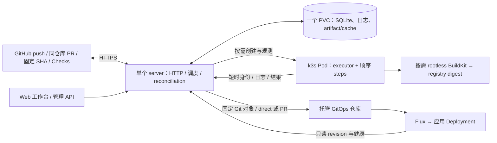

# forgelet：homelab 设计

更新：2026-10-24。当前实现与测试记录见 [status.md](status.md)，后续顺序见 [plan.md](plan.md)。
暂停 spec 模式；设计随代码更新，不设审批或资源基线门禁。

## 当前结构

forgelet 是自己调度、执行和保存历史的 CI/CD。GitHub 是外部源码、事件与 Checks 服务。
首版面向单管理员、可信仓库和自己的 Linux k3s；不自建 Git，不追求完整 Actions 兼容。



- 常驻一个 server Pod；无任务时没有 executor Pod。默认全局并发 4，可配置为 1–1024；实际额度按节点容量设置。
- SQLite 使用 `modernc.org/sqlite`，一个连接、WAL、busy timeout、外键、数据目录文件锁。
  单副本 Recreate；数据库与日志共用数据 PVC，不依赖 PostgreSQL、CRD、Loki、MinIO、消息队列。
- 一个可执行 job 使用一个主 Pod、一个 executor 进程；该 job 的 steps 共享 workspace。
  多个 job 在不同 Pod 并发，不共享环境、输出或工作目录。
- 原生 Pod 使用 `restartPolicy: Never`，不使用 Kubernetes Job 自动重试。
  不使用 GitHub Runner、ARC、Tekton、Docker socket 或 DinD。
- Go >= 1.27，单 module，HTTP/chi、yaml.v3、client-go。executor 不依赖数据库或 Kubernetes client。

SQLite 换来了简单部署，也意味着控制面没有 HA。WAL 不适合共享网络文件系统；k3s local-path
绑定节点，节点故障需要恢复备份。[SQLite WAL](https://www.sqlite.org/wal.html)、[k3s 存储](https://docs.k3s.io/add-ons/storage)

## 一次运行

1. 验证 GitHub webhook HMAC、body 大小、仓库 allowlist 和 delivery ID，先持久化再 ACK。
2. 从 push commit 或同仓库 PR merge commit 读取 `.github/workflows/*.yml/.yaml`，按 workflow allowlist 筛选。
3. 检查事件 filters/inputs，快照 vars，校验 needs DAG 并展开静态 matrix；保存计划、组约束及 secret 引用。未知能力给出诊断，可通过 `/api/events` 查询。
4. SQLite 事务在依赖全部终态后评估 job 条件；检查全局/matrix 额度、并发组与 fail-fast。跳过任务不创建 Pod；领取额度后进入 `starting`。
5. 创建或核对 Pod，记录 UID。executor 以绑定 Pod 的短时身份领取自己的计划，状态变为 `running`。
6. 执行真实 shell、checkout builtin、Node 或 Composite Actions；按需领取该任务引用的 secrets。日志按序号上传，结果附最后日志序号，server 核对后接受终态。
7. 持久化 Checks 待发送状态；失败后重试，不重跑 job。终态已保存才回收对应 UID 的 Pod。

当前默认每秒协调一次：处理事件、观测活跃 Pod、领取新任务、回写 Checks、清理已结束 Pod。
尚未引入 watch、内存任务队列或独立 controller。依赖图最多 64 个逻辑 job，matrix 展开后总计最多 256 个。等待依赖不占并发额度，也不阻塞其他就绪 job。跳过链在同一事务内收敛。
直接 needs 等待整个 matrix 组完成并聚合结果/outputs；同名 output 按展开索引覆盖，避免完成顺序改变结果。
workflow/job 并发组按仓库隔离、忽略大小写，分别保留活跃执行和最新 pending，cancel-in-progress 可取消旧活跃执行。
活跃任务取消意图持久化，确认停止前继续占额度；workflow 在两个依赖 job 之间仍保有组占用。
Matrix 失败/超时/中断与同组取消意图在同一事务保存，即使没有排队 job 也会停止其他活跃变体。

手动 API 可直接提交 workflow 源码用于开发或指定运行；重跑复制原计划创建新 run 和 job ID。
只支持终态 run 重跑，不覆盖历史。GitHub 原生 Run workflow 按钮不是 forgelet 的触发入口。

## 状态与恢复

状态主线是 `queued → starting → running → success/failure/cancelled/timed_out/interrupted/skipped`。
`starting` 和 `running` 都占并发额度，取消意图单独持久化。终态不可倒退。

默认条件隐含 `success()`；上游失败/跳过会使依赖 job 跳过，`failure()`/`always()` 可覆盖该默认门禁。
`failure()` 能看到传递依赖的失败；`needs` 上下文只包含直接依赖的结果和声明 outputs。
就绪时保存依赖结果快照，server 重启后不丢失；重跑保留依赖键但清空旧快照，等待新的依赖执行。
step 普通失败后仍扫描后续条件，清理步骤成功不抹掉此前失败。step `continue-on-error: true` 只忽略普通非零退出，
原 outcome 与最终 conclusion 分别保存；job continue-on-error 保留原 result.state 并调整结论，也不忽略日志/执行器错误或超时。整个 job 超时立即停止该 job 的 steps，
依赖 job 仍按条件调度；管理员取消整个 run 则终止活跃 job 并取消排队 job，不再启动清理任务。完整支持边界见 compatibility。

| 情况 | 当前处理 |
|---|---|
| 重复 webhook | delivery ID 去重；run 再按 delivery ID + workflow 路径去重 |
| Pod 创建成功但响应丢失 | 固定名称核对 owner label 与 UID，领取事务防止另一个 Pod 执行 |
| server 重启、Pod 仍在 | 从 SQLite 恢复额度与计划，继续观测原 UID，executor 有界重连 |
| 已记录 UID 的 Pod 丢失 | 标 interrupted，显式重跑才创建新任务 |
| 管理员取消 | queued 立即取消；活跃任务设置取消意图、删除 Pod，确认终止后释放额度 |
| executor 超时或失败 | 进程组清理，上传日志和明确终态；失联且无法确认结果则由 server 标 interrupted |
| 日志 ACK / 结果响应丢失 | 相同序号、相同内容幂等重试，不再次执行 shell |
| Check 创建响应丢失 | 按 commit、App 与 external_id 查询已有 Check；状态未回写成功则继续重试 |
| 终态已保存但 Pod 未删除 | 依据 owner label 与 UID 幂等清理 |

不承诺外部副作用 exactly-once；失去执行结果不能推断任务从未执行。
[Kubernetes Job 官方说明](https://kubernetes.io/docs/concepts/workloads/controllers/job/)

## Web 工作台

前端位于 `web/`：React 19.3 + TypeScript 7、Vite 8.3、TanStack Router/Query、Tailwind CSS 4.3 与 Lucide。
采用浏览器 SPA，路由按页面拆包；工作台没有 SEO/服务端渲染需求，不引入 SSR 或独立 Node 服务。
Vite 产物通过 `internal/webui` 的 `go:embed` 编入原控制面，Node/npm 仅用于构建与测试。
新增依赖主要增加开发依赖、构建时间和静态文件体积，不增加常驻进程、PVC 或数据库。
字体随包提供，不依赖第三方 CDN。版本固定在 package-lock，使用 npm ci 重现。

- 工作台、运行筛选/详情、needs 分层图、手动创建/取消/重跑、产物下载、发布/Flux 状态与回滚、仓库 vars/secrets、系统水位/保留/备份/事件诊断。
- TanStack Query 管理服务端状态与失效；取消/回滚等操作等待真实 API 响应，不自动重试写操作。筛选和选中 job 保存在 URL，支持深链接和刷新。
- 状态按 2–10 秒轮询，后台页减少活动；日志按 seq 游标持续排空全部 256 块分页，终态后收完最后输出。浏览器按 1000 行分页渲染，支持 step 筛选、文本搜索和跟随输出；完整下载由 Go 流式分页输出。
- Step 结果在 job 完成后确认，不从 job 的 running 状态虚构每一步进度。历史/日志过期、空列表、网络失败和 GitOps 冲突都有明确页面状态。
- `/api/config` 只返回仓库、profile、target、功能开关和保留期；不返回 token、密钥或 registry Secret 引用。Secret 编辑仅写入新值，读取接口继续只返回名称。
- 静态资源使用内容哈希与长期缓存，入口 HTML 不缓存；未知 API/内部路径不会 fallback 到 HTML。启用 CSP、nosniff 和 frame-ancestors，日志以文本呈现。

阶段 4–6 初版使用 `admin_access: open`；阶段 7 按 owner 要求新增管理员/session/GitHub 登录，新安装显式选择 session。已有 open 配置仅用于可信内网/VPN 或开发环境；
浏览器写请求需同源且使用 JSON，跨站 Origin / Fetch Metadata 和表单写请求被拒绝，不启用 CORS。
API token 模式作为已有部署兼容项保留，省略 `admin_access` 时仍是 token 模式，升级不会自动取消现有保护。
Web 工作台使用 session Cookie 登录，已有 open 模式继续兼容，不在浏览器保存 admin token；GitHub webhook HMAC 和 executor workload identity 始终独立校验。

单测使用 Vitest 验证过滤、依赖图、日志与 API 错误行为；Playwright 对完整构建产物测试交互和移动布局。
Testcontainers 在临时 k3s 中安装正式镜像，再启动真实 Chromium，通过页面访问 Go/SQLite、创建执行 Pod、验证取消和重启。

备份 API 用 `VACUUM INTO` 生成包含状态、日志和投递记录的一致性 SQLite 快照，再原子发布；不复制活跃 `.db`。
artifact/cache 存放在同 PVC 的 `blobs/`，不包含在 SQLite 快照中，需另做 PVC 备份（cache 可重建）。
快照带恢复标记，直接作为运行库打开会拒绝启动。恢复前隔离旧控制面和旧执行任务，复制到空目录，
运行 `forgelet --prepare-restore <db>`：非终态任务标 interrupted，未处理事件和活跃 CD 投递隔离，之后才允许启动。
已存在的远端 PR/commit 不自动撤销，恢复时核对远端状态后再提交新投递，防止旧快照重放部署。
普通进程重启不执行此操作。配置、TLS/App key 等 Kubernetes Secret 另行备份；快照之后的历史可能丢失。
加密 secrets 需要另外备份主密钥，否则 SQLite 快照中的密文无法恢复。具体命令见 [deployment.md](deployment.md)。

## 可操作的接入配置

`/connections`、`/workflows`、`/targets` 提供仓库、workflow、发布目标管理，沿用当前配置的管理模式；阶段 7 新安装使用 session，已有 open/token 保留兼容。
`GET/PUT /api/management` 读写一个包含 version/repositories/workflows/targets 的有界文档；`POST /api/management/inspect` 使用登记 installation 读取固定 SHA 的 GitHub workflow。
GitHub App 私钥、webhook secret、加密主密钥、执行 profile 和基础设施配置继续由安装文件/Secret 管理，不通过页面下发或回显。

配置保存在现有 SQLite metadata 的 management 行（不增加 schema 版本或依赖），随数据库快照备份。保存先比较客户端 version，再以数据库 CAS 提交；成功后原子替换只读运行快照。
配置保存与协调 tick 串行，HTTP 读取使用不可变快照；旧编辑返回 409 并保留用户表单内容，需要显式重新加载。
未保存时从安装文件的 repositories/workflows/targets 生成初始值；第一次保存后，这三项由 SQLite 接管，后续改 ConfigMap 不覆盖页面设置。其他安装配置仍按进程启动加载。

- 仓库关闭/移除后不接收新运行；尚未处理的事件被结束并记录原因，不创建 Pod。不主动取消运行中任务；vars/secrets 与历史不会因删配置清除，改仓库名称不迁移这些数据。
- 每仓库未登记 workflow 时继续发现 Git 文件；有登记规则时只执行启用路径。Git 模式从事件 SHA 读文件；控制面 YAML 显式保存在配置中，不写回 Git，全部已启用规则都是控制面 YAML 时无需读取 Git workflow 目录。
- YAML 保存检查受支持字段、依赖/表达式、profile 与输入定义，即使当前事件不匹配过滤器也验证 job；实际执行仍使用原触发规则并编译为持久化计划。保存源码不会执行任务，已有 run 计划不变。
- target 验证与原文件配置相同，并要求已登记的来源仓库和可用 GitHub/Flux adapter。配置仅影响后续投递请求，持久化 delivery 自带 target 快照；删除 target 后尚未发起投递的任务无法再使用该名称。
- 页面登记 installation 不代替 GitHub 授权，不创建 App、不修改 App 安装范围或 webhook；接入检查使用已有 App 权限，远端失败返回诊断。

## GitHub 自助接入（阶段 6 第一批）

阶段 6 第一批沿用同一个 Go server、SQLite metadata 配置和无登录内网管理模式；当时没有 OAuth、用户或会话。阶段 7 在同一个 Go/SQLite 中补充管理员与 OAuth，仍不增加服务或数据库。

- `GET /api/github/connection` 用 App JWT 确认 App 身份并分页枚举本 App installations，再用仅 metadata:read 的短期 installation token 分页发现仓库。整个快照完整成功才返回；失败不修改登记配置，不将部分列表解释为撤权。每次显式刷新重新签发 metadata token，使新增授权立即可见。API 响应有界且不返回凭证。
- 页面提供 App 安装入口、个人/组织安装的仓库授权入口及“我已授权，刷新仓库”。授权页面在 GitHub 新标签打开，返回后显式刷新；不信任 URL 的 installation_id/setup_action，不实现身份绑定回调。无法通过本 App API 看到的待批准组织安装只提示需要管理员批准，不伪造待批准记录。
- `POST /api/github/enable` 接收 repository_id 与配置 version；服务端重新查询权威目录、核对 Contents/Checks 权限、归档/暂停，解析名称和 installation。仓库授权与 CI 启用分开，不自动启用 GitOps 仓库。绑定保留稳定 repository ID，重命名返回明确冲突，要求显式迁移 workflow/target；本批不自动迁移历史或 settings。
- `POST /api/github/preview` 对已启用且 ID/installation 匹配的仓库，解析默认分支的完整 SHA，再从固定 SHA 读取 workflow，应用现有 Git/控制面规则。分别检查语法/支持字段、profile 和实际触发条件，返回逐文件诊断；支持 push 或 workflow_dispatch/inputs。path filters 缺少真实变更集时明确诊断，不伪造 files 绕过条件。
- `POST /api/github/run` 重新检查授权并从预检 SHA 读取源码，校验配置未并发变化后创建原有 run。分支移动不改变已经检查的 SHA。request_id 与仓库/SHA/path/ref/event/inputs/源码组成持久化幂等身份，网络重试不会重复创建相同首跑。执行沿用现有 Pod、Checks、日志和产物链路。
- 第一批只做手动同步与接入/首跑时的权威检查；installation 生命周期事件、定期校正、撤权后清理排队运行/凭证缓存、批量启用和自动 rename 迁移留到下一批。已有 webhook 调度继续沿用登记 allowlist；不能把首跑的授权检查当作这些后台能力已完成。

## 管理员与 GitHub 登录（阶段 7）

2026-10-24 owner 开始引入账号功能。新安装显式 `admin_access: session`；已有 open/token 配置继续兼容，不在代码升级时隐式切换实际部署。

- 只有一个本地 `admin`，初次启动从 Secret 文件读取或生成随机初始密码到 `/data/initial-admin-password`（0600）；bcrypt 哈希入 SQLite。管理员记录已存在时不再读取 bootstrap 密码，普通重启不会覆盖改过的密码。没有用户注册、邀请、团队和多租户。
- session 是 32 随机字节，SQLite 仅存 SHA-256 摘要；Cookie 为 HttpOnly、HTTPS Secure、SameSite=Lax，7 天绝对到期。数据库有界保留 32 个 session / 16 个十分钟 OAuth flow。退出撤销当前 session，改密事务更新哈希并撤销所有 session/flow，再发新 Cookie。备份恢复隔离时撤销恢复出来的 session 和 flow。
- 匿名只访问登录状态、密码登录、OAuth 启动/回调、静态 bundle 和健康探针；管理 API 全部要求有效 session，不接受旧 Bearer token 作为旁路。写请求同源 JSON 校验继续生效。密码登录按真实远端地址每分钟最多 6 次，不信任客户端提供的转发 IP。
- 使用独立 GitHub OAuth App 的 `read:user repo` 授权做账号登录与用户仓库发现。初次关联须本地管理员登录；登录回调以 GitHub ID 匹配已关联管理员，不能将第一个 GitHub 访问者自动提升为管理员。没有按用户名/email 自动合并身份。
- OAuth 使用随机 state + 浏览器绑定 Cookie + S256 PKCE，关联 flow 另绑定发起 session；flow 在网络兑换之前原子消费，拒绝超时/重放/跨浏览器/已退出的关联回调。服务端固定回调和返回路径，不接受任意跳转。凭据兑换、身份核对和 API 都有超时且不跟随跨站重定向；错误不返回远端响应体或 token。
- OAuth token bundle 使用 AES-GCM 和独立 AAD 加密。优先复用已配置的 32-byte 主密钥，否则在 PVC 创建 `auth-encryption.key`（0600）；后者需随 PVC 备份，不能仅备份 SQLite。过期前按 refresh token 更新并重新核对 GitHub ID；授权撤销或无法刷新时要求重新连接。
- Connections 主视图只显示已经登记的仓库，分别呈现 CI 开关、GitHub 授权和最近运行。添加仓库使用独立弹窗：打开时才读取 OAuth `/user/repos`，搜索后展示每页 6 个结果并可筛选账号。启用前重新读取用户管理权限及本 App 权威目录；尚未授权、安装缺失/暂停或权限不足时返回 HTTP 202 `authorization_required` 和服务端生成的 GitHub 操作地址，不改变可信配置。用户在 GitHub 完成授权后明确点击复核，只有目录确认 repository ID/name/installation/权限后才 CAS 保存。选择的待授权 repository ID 可保存在浏览器 sessionStorage 以便刷新继续，不能作为可信授权证据。
- **2026-10-24 修正**：独立 OAuth App 的 `repo` token 不能用于修改 GitHub App installation，移除此前错误的自动授权调用。GitHub 登录用于身份与仓库发现，安装仓库授权仍由 GitHub 确认；没有引入 PAT、放宽为所有仓库或以 OAuth token 替代执行凭据。GitHub App 继续负责集中 webhook、限定仓库的短期执行凭据、Checks 与原 CD，OAuth token 不下发给 Pod。
- App 尚未安装于新组织或组织策略阻止操作时，明确提示一次性安装/批准；OAuth 登录不会绕过组织策略。对已有 App 的仓库授权即接通集中 webhook，无需重复申请另一组 repository webhook。范围同步/批量/rename 仍按阶段 6 后续计划推进。

以上只增加 SQLite 表和原 Go 服务内的处理；复用现有 x/crypto，不增加运行服务或外部数据库。测试中 GitHub 是受控 OAuth/API fixture，真实 Chromium → Go → SQLite → 执行 Pod 在临时 k3s 验证，不能当作真实 GitHub 账号授权成功。

## 执行、身份与日志

`runs-on` 是管理员配置的 profile 名称，指定镜像、CPU/内存额度、节点标签。
默认 executor 改为 Debian/glibc，含 git/bash 与独立 Node 20/24 runtime；Go 可通过已验证的 setup-go 安装，也可预装工具链。
常驻 server 保持 Go/Alpine，不因 Node 增加常驻服务。工具缓存、Action 源码在 job 生命周期内临时保存。
没有隐式 `ubuntu-latest` 环境，已支持语义见 [compatibility.md](compatibility.md)。

- 主容器非 root、禁止提权、drop ALL、RuntimeDefault seccomp；workspace 使用有大小上限的 emptyDir。
  挂载根 `/workspace` 由 k3s 创建，执行器在其下创建自己所有的 `/workspace/repository` 作为 `GITHUB_WORKSPACE`，
  保证默认 checkout 通过 Git 所有权检查；工作流应使用该环境变量，不依赖固定绝对路径。
- Executor 禁止自动挂载 SA token，显式投影 600 秒、audience=forgelet 的 workload token。
  server 经 TokenReview 验证 namespace、SA、Pod 名称/UID、实际 Pod 和 job 绑定。
  executor SA 无 Kubernetes RBAC；TokenReview 的集群权限只授予 server。
- 短时 token 值不注入 step 环境，但同容器可信代码仍可读投影文件；只能访问自己的 job。
  当前没有恶意代码沙箱或已经验证的 NetworkPolicy，不执行 fork PR 等不可信代码。
- GitHub clone token 限定仓库和 contents:read，通过认证接口临时下发，不写入计划。
  Git checkout 临时传入认证 header，不把凭证留在 `.git/config`。Checks 写 token 与 clone token 分开。
- Admin API 支持显式 open 模式和已有 Bearer token 模式。token 模式下旧 Basic 只读访问继续兼容，不能写入。
  Web 工作台当前优先使用 session 账号模式，已有 open 模式保留；内部回调默认 HTTPS，HTTP 只允许显式开发覆盖。
- 仓库 secrets 使用 AES-256-GCM，随机 nonce 和仓库/名称 AAD；32 bytes 主密钥独立挂载给 server。SQLite/备份仅存密文，计划仅存名称引用。
  executor 按任务身份领取引用的 secret 值，执行前注册 mask；vars 明文保存并在 run 创建时快照，重跑仍使用该快照。
- 日志做跨 chunk、多行、动态 mask，含已注册值的输出不发布。Masking 不能阻止可信代码主动外传。

当前日志直接存 SQLite，便于事务确认与一致性备份。每 job 上限 20 MiB（包含每块记账开销），
上传块上限 64 KiB；executor 实际按 8 KiB 分包，待上传缓冲上限 1 MiB，支持背压与取消后有界 flush。
超过存储上限返回明确错误，job 不能伪报成功；不是静默截断。
API 每次返回最多 256 块，按 `after` 续读；SSE 支持断点。Web 持续排空日志分页，下载接口流式返回全部块。
运行列表目前最多最近 100 条。默认每 10 分钟分批清理：日志 7 天、历史 30 天、已处理事件 payload 30 天、备份 7 天；
管理员可调用 `POST /api/maintenance` 立即执行同一策略。保留期从终态时间计算（事件按接收时间、备份按修改时间），
不是从 job 创建时间计算；整个 run 未完成或仍有对应 Pod 时保护其历史和日志。真实 GitHub Checks 待回写时保留历史。
日志过期后标记 `logs_expired`，日志 JSON/SSE 请求返回 410，详情页仍展示结果；历史过期后返回 404。
保留事件 delivery 身份和 run 唯一键的精简去重记录，旧 webhook 不会因历史清理而再执行。
备份只删除本程序命名的过期普通快照文件，不删除活动数据库、临时文件、目录或符号链接。

SQLite schema 在事务中自动从 v1/v2/v3/v4 升级到 v5；v3 增加仓库 settings，v4 增加带 CAS 版本的 CD 投递记录，v5 增加单管理员、会话摘要和有时限 OAuth flow，旧 run 计划仍可读取。新库启用 incremental auto-vacuum，清理后有界回收；旧库删除页可复用，
不会自动 full VACUUM 重写数据库，也不保证立即缩小文件。去重元数据继续保留。

控制面每个调度 tick 及创建执行 Pod 前，通过 `statfs(data_dir)` 检查当前进程可用字节（`Bavail`，不含特权保留块）。
默认低于 512 MiB 暂停新任务，恢复到至少 1 GiB 后自动继续；两个阈值可配置，中间区间保持原状态，避免反复切换。
探测失败时暂停新任务并记录诊断；初次启动/重启也从暂停开始，达到恢复阈值才放行，不向受压磁盘额外写入水位状态。
SQLite 中 queued 保持排队；已经预留但尚无 Pod 的 starting attempt 同样等待，恢复后使用原身份继续。
现有 Pod 的 UID 接管、日志/结果、取消、依赖条件与失败传播、Checks、Pod GC、CD 协调和保留清理继续执行。
管理员 `GET /api/status` 与首页显示暂停原因、可用空间、阈值和最近探测时间；健康探针不因暂停失败。
保护针对数据目录所在文件系统，不把 local-path 的 PVC request 当硬配额，也不监控 executor workspace / 镜像缓存所在的其他文件系统。
正在执行的任务、上传、接收事件和备份仍会消耗空间，阈值不是预留容量或全量写入配额；保留期不因压力而缩短。
没有增加 schema、产品运行时依赖或常驻组件；容器测试直接引用原有 moby API 模块以配置隔离挂载。
空间恢复后在下一次调度检查放行，外部 I/O 会影响 tick 完成时间。

## Actions 与 CI 到 CD

阶段 2 已实现 needs/matrix/并发组、表达式子集、真实 Node/Composite、PR/filters/inputs 与 secrets。
表达式区分接收时固定值、调度条件和执行期插值，明确可用上下文；`internal/workflow` 仍无外部 I/O。
Action resolver 仅下载公开固定 SHA 源码，限制归档路径/体积；executor 解析 metadata，使用 Node 20/24 子进程，
每次调用有独立 inputs/state/outputs。pre 在调用前执行，post 在 job 结束逆序执行；整个 job 取消/超时不再执行新 post。
Composite 复用同一主容器、workspace 与 file commands，嵌套有界；setup-go/setup-node 的固定版本和输入通过实际工具安装验证。
全部行为限制见 compatibility，当前不等于任意 Marketplace Action 均可使用。

第三阶段已实现以下链路：

```text
测试成功 → BuildKit → 外部 registry 中的 immutable digest
        → 更新托管 GitOps 仓库 → Flux reconcile → 关联 revision 与应用健康
```

artifact/cache 是本地文件服务，无新增常驻进程；默认单对象 256 MiB、总计 2 GiB、4096 对象，临时上传预留量也计入限额。
上传写临时目录、同步文件后 rename 发布；重启清理未发布目录。artifact 按仓库/run/name 隔离且不可覆盖，
cache 按仓库/ref/版本/key 隔离，版本含 OS/架构/路径，first writer wins。缓存使用有界 tar 与 workspace 路径检查，拒绝链接和路径逃逸。
默认 artifact/cache 保留 7 天，artifact 可选 1–90 天；GC 按到期时间执行，终态 CD 历史按 history 保留期清理。
`queued` 投递保护源 run 历史；每个 target 最新 delivered/deployed 记录保留，旧投递进入 superseded 后可清理。

`forgelet/build@v1` 仅在显式启用 build profile 的 job 中启动 `moby/buildkit:v0.20.2-rootless` 原生 sidecar；
buildctl 在 executor 中运行，经共享 Unix socket 连接 builder，构建数据是 8 GiB emptyDir，原生 sidecar 随主容器终止。
builder UID 1000、无 privileged/hostPath/Docker socket；rootlesskit 需要 SETUID/SETGID、允许提权以及 Unconfined seccomp/AppArmor，
仅 builder 有这些设置。使用 native snapshotter 和 no-process-sandbox，仅面向可信仓库；需要支持原生 sidecar 的 k3s 和节点 user namespace。
executor 继续禁止提权与 drop ALL。Registry Secret 只挂给该 build job 的 executor，认证通过 BuildKit session 传递；不挂 workload token 给 builder。
profile 限制可推送的 image repository，step 无法开启 insecure registry；输出不可变 sha256 digest，构建/失败/取消均有真实临时 k3s 验证。

GitOps 写凭证由控制面持有，step 只提交预登记 target 和 digest。整个 run 成功后才处理 queued 意图；
SQLite 先保存 base SHA/目标文件，再保存确定性 Git commit SHA，最后发布非强推分支更新或固定分支 PR。
同 target 写入串行，待合并 PR 会阻塞该 target 的新写入；冲突需要新 run，响应丢失通过远端固定对象/PR 查询恢复。
PR 合并前是 awaiting_merge，实际 merge SHA 进入目标分支才是 delivered；GitRepository/Kustomization 来源、revision、generation、inventory、
Deployment 的实际 image/更新副本/可用副本都吻合才是 deployed。之后仍检查健康，退化退回 delivered，后续镜像或投递取代时进入 superseded。
CD 观测只读 Flux 和应用资源，不给 executor Kubernetes API 权限。每 tick 有界扫描最多 1024 条活跃投递，target 上限 32。
新意图继续随调度 tick 推进；等待合并/部署的远端观测及失败重试每 30 秒一次，已健康部署每 2 分钟一次，避免空闲时每秒调用 GitHub。
轮询计时是可丢弃的进程内状态，重启立即重新核对，持久化投递身份和 Git 对象仍负责幂等。
回滚创建独立投递记录，以新 revert commit 恢复前一个 digest，保留其他修改；当前 image 已改变则 conflict，重复请求返回同一回滚。
不支持任意文件替换、任意 Git revert、HelmRelease 或任意 workload 健康检查。Flux 由环境单独管理，forgelet 不安装或持有它的写权限。
Flux、构建器、语言工具链的资源与常驻控制面分开考虑；目前不启用跨 job BuildKit 层缓存。
[BuildKit](https://github.com/moby/buildkit/blob/master/docs/rootless.md)、[Flux](https://fluxcd.io/flux/components/kustomize/kustomizations/)

## 资源与代码组织

当前安装示例：server request 50m/128Mi、limit 1 CPU/512Mi；executor request 100m/128Mi、
limit 1 CPU/1Gi；PVC 10Gi。它们是可修改的配置，不是测量结果，不作为本轮性能验收门禁。
先完成可运行功能和自动测试，按真实使用情况再优化常驻占用。

| 目录 | 职责 |
|---|---|
| `cmd/forgelet` / `cmd/executor` | 进程装配、配置与管理命令 / 单 job 执行入口 |
| `internal/run` | 计划、状态与接口数据类型 |
| `internal/workflow` / `internal/expression` | YAML、触发/输入/依赖/matrix/Action metadata 校验 / 有界纯逻辑表达式与插值 |
| `internal/action` | 公开固定 SHA Action 引用与有界源码归档下载 |
| `internal/blob` | 有界文件存储、原子发布、保留清理与 tar 路径验证 |
| `internal/delivery` | 预登记 target、GitOps 状态机、限定 Kustomize image 修改与回滚 |
| `internal/storage` | SQLite 事务调度、历史、日志、Checks 待发状态、备份 |
| `internal/server` | HTTP、管理访问、协调循环与控制台 API |
| `internal/webui` / `web` | 嵌入静态资源与 SPA 路由 / React 工作台及浏览器测试 |
| `internal/kube` | Pod/BuildKit 构造、观测、清理、workload 身份与只读 Flux observer |
| `internal/provider/github` | App/JWT、事件、workflow 获取、限权 token、Checks、Git Data 与 PR 发布 |
| `internal/executor` | shell/git、Node/Composite 生命周期、file commands、脱敏、远程协议 |
| `deploy` / `test/integration` | 安装清单 / Testcontainers 临时 k3s 集成测试 |

依赖方向为 `cmd → application/adapters → domain`。不创建空模块或 common/shared/utils 包。
