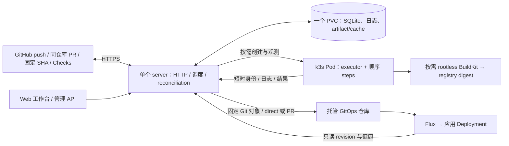

# forgelet：homelab 设计

更新：2026-10-27。当前实现与测试记录见 [status.md](status.md)，后续顺序见 [plan.md](plan.md)。
暂停 spec 模式；设计随代码更新，不设审批或资源基线门禁。

## 当前结构

forgelet 是自己调度、执行和保存历史的 CI/CD。GitHub 是外部源码、事件与 Checks 服务。
首版面向单管理员、可信仓库和自己的 Linux k3s；不自建 Git，不追求完整 Actions 兼容。



- 常驻一个 server Pod；无任务时没有 executor Pod。默认全局并发 4，可配置为 1–1024；实际额度按节点容量设置。
- SQLite 使用 `modernc.org/sqlite`，一个连接、WAL、busy timeout、外键、数据目录文件锁。
  单副本 Recreate；数据库与日志共用数据 PVC，不依赖 PostgreSQL、CRD、Loki、MinIO、消息队列。
- 一个可执行 job 使用一个主 Pod、一个 executor 进程；该 job 的 steps 共享 workspace。
  多个 job 在不同 Pod 并发，不共享环境、输出或工作目录。
- 原生 Pod 使用 `restartPolicy: Never`，不使用 Kubernetes Job 自动重试。
  不使用 GitHub Runner、ARC 或 Tekton。默认 native profile 不使用 Docker；10.5b 显式 act profile 使用 Pod 自有按需 Docker，不挂宿主 socket。
- Go >= 1.27，单 module，HTTP/chi、actionlint/YAML v4 workflow 前端、YAML v3 系统配置、client-go。executor 不依赖数据库或 Kubernetes client。

SQLite 换来了简单部署，也意味着控制面没有 HA。WAL 不适合共享网络文件系统；k3s local-path
绑定节点，节点故障需要恢复备份。[SQLite WAL](https://www.sqlite.org/wal.html)、[k3s 存储](https://docs.k3s.io/add-ons/storage)

## 一次运行

1. 验证 GitHub webhook HMAC、body 大小、仓库 allowlist 和 delivery ID，先持久化再 ACK。
2. 从 push commit 或同仓库 PR merge commit 读取 `.github/workflows/*.yml/.yaml` 完整快照，按 workflow allowlist 筛选触发入口，同时保留辅助调用文件。
3. 检查事件 filters/inputs，快照 vars，校验 needs DAG，展开同仓库 workflow_call 与静态 matrix；act job 在持久化前将公共 Action ref 与远程 Composite 依赖解析到固定 SHA，再保存 gate/子图/result 计划、组约束及 secret 引用。未知能力给出诊断，可通过 `/api/events` 查询。
4. SQLite 事务在依赖全部终态后评估 job 条件；检查全局/matrix 额度、并发组与 fail-fast。跳过任务不创建 Pod；领取额度后进入 `starting`。
5. 创建或核对 Pod，记录 UID。executor 以绑定 Pod 的短时身份领取自己的计划，状态变为 `running`。
6. 执行真实 shell、checkout builtin、Node 或 Composite Actions；按需领取该任务引用的 secrets。日志按序号上传，结果附最后日志序号，server 核对后接受终态。
7. 持久化 Checks 待发送状态；失败后重试，不重跑 job。终态已保存才回收对应 UID 的 Pod。

当前默认每秒协调一次：处理事件、观测活跃 Pod、领取新任务、回写 Checks、清理已结束 Pod。
尚未引入 watch、内存任务队列或独立 controller。依赖图最多 64 个逻辑 job，matrix 展开后总计最多 256 个。等待依赖不占并发额度，也不阻塞其他就绪 job。跳过链在同一事务内收敛。
直接 needs 等待整个 matrix 组完成并聚合结果/outputs；同名 output 按展开索引覆盖，避免完成顺序改变结果。
workflow/job 并发组按仓库隔离、忽略大小写，分别保留活跃执行和最新 pending，cancel-in-progress 可取消旧活跃执行。
活跃任务取消意图持久化，确认停止前继续占额度；workflow 在两个依赖 job 之间仍保有组占用。
Matrix 失败/超时/中断与同组取消意图在同一事务保存，即使没有排队 job 也会停止其他活跃变体。

手动 API 可直接提交 workflow 源码用于开发或指定运行；重跑复制原计划创建新 run 和 job ID。
只支持终态 run 重跑，不覆盖历史。GitHub 原生 Run workflow 按钮不是 forgelet 的触发入口。

## 状态与恢复

状态主线是 `queued → starting → running → success/failure/cancelled/timed_out/interrupted/skipped`。
`starting` 和 `running` 都占并发额度，取消意图单独持久化。终态不可倒退。

默认条件隐含 `success()`；上游失败/跳过会使依赖 job 跳过，`failure()`/`always()` 可覆盖该默认门禁。
`failure()` 能看到传递依赖的失败；`needs` 上下文只包含直接依赖的结果和声明 outputs。
就绪时保存依赖结果快照，server 重启后不丢失；重跑保留依赖键但清空旧快照，等待新的依赖执行。
step 普通失败后仍扫描后续条件，清理步骤成功不抹掉此前失败。step `continue-on-error: true` 只忽略普通非零退出，
原 outcome 与最终 conclusion 分别保存；job continue-on-error 保留原 result.state 并调整结论，也不忽略日志/执行器错误或超时。整个 job 超时立即停止该 job 的 steps，
依赖 job 仍按条件调度；管理员取消整个 run 则终止活跃 job 并取消排队 job，不再启动清理任务。完整支持边界见 compatibility。

| 情况 | 当前处理 |
|---|---|
| 重复 webhook | delivery ID 去重；run 再按 delivery ID + workflow 路径去重 |
| Pod 创建成功但响应丢失 | 固定名称核对 owner label 与 UID，领取事务防止另一个 Pod 执行 |
| server 重启、Pod 仍在 | 从 SQLite 恢复额度与计划，继续观测原 UID，executor 有界重连 |
| 已记录 UID 的 Pod 丢失 | 标 interrupted，显式重跑才创建新任务 |
| 管理员取消 | queued 立即取消；活跃任务设置取消意图、删除 Pod，确认终止后释放额度 |
| executor 超时或失败 | 进程组清理，上传日志和明确终态；失联且无法确认结果则由 server 标 interrupted |
| 日志 ACK / 结果响应丢失 | 相同序号、相同内容幂等重试，不再次执行 shell |
| Check 创建响应丢失 | 按 commit、App 与 external_id 查询已有 Check；状态未回写成功则继续重试 |
| 终态已保存但 Pod 未删除 | 依据 owner label 与 UID 幂等清理 |

不承诺外部副作用 exactly-once；失去执行结果不能推断任务从未执行。
[Kubernetes Job 官方说明](https://kubernetes.io/docs/concepts/workloads/controllers/job/)

## Web 工作台

前端位于 `web/`：React 19.3 + TypeScript 7、Vite 8.3、TanStack Router/Query、Tailwind CSS 4.3 与 Lucide。
采用浏览器 SPA，路由按页面拆包；工作台没有 SEO/服务端渲染需求，不引入 SSR 或独立 Node 服务。
Vite 产物通过 `internal/webui` 的 `go:embed` 编入原控制面，Node/npm 仅用于构建与测试。
新增依赖主要增加开发依赖、构建时间和静态文件体积，不增加常驻进程、PVC 或数据库。
字体随包提供，不依赖第三方 CDN。版本固定在 package-lock，使用 npm ci 重现。

- 工作台、运行筛选/详情、needs 分层图、手动创建/取消/重跑、产物下载、发布/Flux 状态与回滚、仓库 vars/secrets、系统水位/保留/备份/事件诊断。
- TanStack Query 管理服务端状态与失效；取消/回滚等操作等待真实 API 响应，不自动重试写操作。筛选和选中 job 保存在 URL，支持深链接和刷新。
- 状态按 2–10 秒轮询，后台页减少活动；日志按 seq 游标持续排空全部 256 块分页，终态后收完最后输出。浏览器按 1000 行分页渲染，支持 step 筛选、文本搜索和跟随输出；完整下载由 Go 流式分页输出。
- Step 结果在 job 完成后确认，不从 job 的 running 状态虚构每一步进度。历史/日志过期、空列表、网络失败和 GitOps 冲突都有明确页面状态。
- `/api/config` 只返回仓库、profile、target、功能开关和保留期；不返回 token、密钥或 registry Secret 引用。Secret 编辑仅写入新值，读取接口继续只返回名称。
- 静态资源使用内容哈希与长期缓存，入口 HTML 不缓存；未知 API/内部路径不会 fallback 到 HTML。启用 CSP、nosniff 和 frame-ancestors，日志以文本呈现。

阶段 4–6 初版使用 `admin_access: open`；阶段 7 按 owner 要求新增管理员/session/GitHub 登录，新安装显式选择 session。已有 open 配置仅用于可信内网/VPN 或开发环境；
session/open 模式的管理写请求需同源且使用 JSON，跨站 Origin / Fetch Metadata 和表单写请求被拒绝，不启用 CORS。旧 token 模式要求显式 Bearer，不使用 Cookie 授权写入，不额外套用浏览器同源检查。
API token 模式作为已有部署兼容项保留，省略 `admin_access` 时仍是 token 模式，升级不会自动取消现有保护。
Web 工作台使用 session Cookie 登录，已有 open 模式继续兼容，不在浏览器保存 admin token；GitHub webhook HMAC 和 executor workload identity 始终独立校验。

单测使用 Vitest 验证过滤、依赖图、日志与 API 错误行为；Playwright 对完整构建产物测试交互和移动布局。
Testcontainers 在临时 k3s 中安装正式镜像，再启动真实 Chromium，通过页面访问 Go/SQLite、创建执行 Pod、验证取消和重启。

备份 API 用 `VACUUM INTO` 生成包含状态、日志和投递记录的一致性 SQLite 快照，再原子发布；不复制活跃 `.db`。
artifact/cache 存放在同 PVC 的 `blobs/`，不包含在 SQLite 快照中，需另做 PVC 备份（cache 可重建）。
快照带恢复标记，直接作为运行库打开会拒绝启动。恢复前隔离旧控制面和旧执行任务，复制到空目录，
运行 `forgelet --prepare-restore <db>`：非终态任务标 interrupted，未处理事件和活跃 CD 投递隔离，之后才允许启动。
已存在的远端 PR/commit 不自动撤销，恢复时核对远端状态后再提交新投递，防止旧快照重放部署。
普通进程重启不执行此操作。配置、TLS/App key 等 Kubernetes Secret 另行备份；快照之后的历史可能丢失。
加密 secrets 需要另外备份主密钥，否则 SQLite 快照中的密文无法恢复。具体命令见 [deployment.md](deployment.md)。

## 可操作的接入配置

`/connections`、`/workflows`、`/targets` 提供仓库、workflow、发布目标管理，沿用当前配置的管理模式；阶段 7 新安装使用 session，已有 open/token 保留兼容。
`GET/PUT /api/management` 读写一个包含 version/repositories/workflows/targets 的有界文档；`POST /api/management/inspect` 使用登记 installation 读取固定 SHA 的 GitHub workflow。
GitHub App 私钥、webhook secret、加密主密钥、执行 profile 和基础设施配置继续由安装文件/Secret 管理，不通过页面下发或回显。

配置保存在现有 SQLite metadata 的 management 行（不增加 schema 版本或依赖），随数据库快照备份。保存先比较客户端 version，再以数据库 CAS 提交；成功后原子替换只读运行快照。
配置保存与协调 tick 串行，HTTP 读取使用不可变快照；旧编辑返回 409 并保留用户表单内容，需要显式重新加载。
未保存时从安装文件的 repositories/workflows/targets 生成初始值；第一次保存后，这三项由 SQLite 接管，后续改 ConfigMap 不覆盖页面设置。其他安装配置仍按进程启动加载。

- 仓库关闭/移除后不接收新运行；尚未处理的事件被结束并记录原因，不创建 Pod。不主动取消运行中任务；vars/secrets 与历史不会因删配置清除，改仓库名称不迁移这些数据。
- 每仓库未登记 workflow 时继续发现 Git 文件；有登记规则时只执行启用路径。Git 模式从事件 SHA 读文件；控制面 YAML 显式保存在配置中，不写回 Git，全部已启用规则都是控制面 YAML 时无需读取 Git workflow 目录。
- YAML 保存检查受支持字段、依赖/表达式、profile 与输入定义，即使当前事件不匹配过滤器也验证 job；实际执行仍使用原触发规则并编译为持久化计划。保存源码不会执行任务，已有 run 计划不变。
- target 验证与原文件配置相同，并要求已登记的来源仓库和可用 GitHub/Flux adapter。配置仅影响后续投递请求，持久化 delivery 自带 target 快照；删除 target 后尚未发起投递的任务无法再使用该名称。
- 页面登记 installation 不代替 GitHub 授权，不创建 App、不修改 App 安装范围或 webhook；接入检查使用已有 App 权限，远端失败返回诊断。

## GitHub 自助接入（阶段 6 第一批）

阶段 6 第一批沿用同一个 Go server、SQLite metadata 配置和无登录内网管理模式；当时没有 OAuth、用户或会话。阶段 7 在同一个 Go/SQLite 中补充管理员与 OAuth，仍不增加服务或数据库。

- `GET /api/github/connection` 用 App JWT 确认 App 身份并分页枚举本 App installations，再用仅 metadata:read 的短期 installation token 分页发现仓库。整个快照完整成功才返回；失败不修改登记配置，不将部分列表解释为撤权。每次显式刷新重新签发 metadata token，使新增授权立即可见。API 响应有界且不返回凭证。
- 页面提供 App 安装入口、个人/组织安装的仓库授权入口及“我已授权，刷新仓库”。授权页面在 GitHub 新标签打开，返回后显式刷新；不信任 URL 的 installation_id/setup_action，不实现身份绑定回调。无法通过本 App API 看到的待批准组织安装只提示需要管理员批准，不伪造待批准记录。
- `POST /api/github/enable` 接收 repository_id 与配置 version；服务端重新查询权威目录、核对 Contents/Checks 权限、归档/暂停，解析名称和 installation。仓库授权与 CI 启用分开，不自动启用 GitOps 仓库。绑定保留稳定 repository ID，重命名返回明确冲突，要求显式迁移 workflow/target；本批不自动迁移历史或 settings。
- `POST /api/github/preview` 对已启用且 ID/installation 匹配的仓库，解析默认分支的完整 SHA，再从固定 SHA 读取 workflow，应用现有 Git/控制面规则。分别检查语法/支持字段、profile 和实际触发条件，返回逐文件诊断；支持 push 或 workflow_dispatch/inputs。path filters 缺少真实变更集时明确诊断，不伪造 files 绕过条件。
- `POST /api/github/run` 重新检查授权并从预检 SHA 读取源码，校验配置未并发变化后创建原有 run。分支移动不改变已经检查的 SHA。request_id 与仓库/SHA/path/ref/event/inputs/源码组成持久化幂等身份，网络重试不会重复创建相同首跑。执行沿用现有 Pod、Checks、日志和产物链路。
- 第一批只做手动同步与接入/首跑时的权威检查；installation 生命周期事件、定期校正、撤权后清理排队运行/凭证缓存、批量启用和自动 rename 迁移留到下一批。已有 webhook 调度继续沿用登记 allowlist；不能把首跑的授权检查当作这些后台能力已完成。

## 管理员与 GitHub 登录（阶段 7）

2026-10-24 owner 开始引入账号功能。新安装显式 `admin_access: session`；已有 open/token 配置继续兼容，不在代码升级时隐式切换实际部署。

- 只有一个本地 `admin`，初次启动从 Secret 文件读取或生成随机初始密码到 `/data/initial-admin-password`（0600）；bcrypt 哈希入 SQLite。管理员记录已存在时不再读取 bootstrap 密码，普通重启不会覆盖改过的密码。没有用户注册、邀请、团队和多租户。
- session 是 32 随机字节，SQLite 仅存 SHA-256 摘要；Cookie 为 HttpOnly、HTTPS Secure、SameSite=Lax，7 天绝对到期。数据库有界保留 32 个 session / 16 个十分钟 OAuth flow。退出撤销当前 session，改密事务更新哈希并撤销所有 session/flow，再发新 Cookie。备份恢复隔离时撤销恢复出来的 session 和 flow。
- 匿名只访问登录状态、密码登录、OAuth 启动/回调、静态 bundle 和健康探针；管理 API 全部要求有效 session，不接受旧 Bearer token 作为旁路。写请求同源 JSON 校验继续生效。密码登录按真实远端地址每分钟最多 6 次，不信任客户端提供的转发 IP。
- 使用独立 GitHub OAuth App 的 `read:user repo` 授权做账号登录与用户仓库发现。初次关联须本地管理员登录；登录回调以 GitHub ID 匹配已关联管理员，不能将第一个 GitHub 访问者自动提升为管理员。没有按用户名/email 自动合并身份。
- OAuth 使用随机 state + 浏览器绑定 Cookie + S256 PKCE，关联 flow 另绑定发起 session；flow 在网络兑换之前原子消费，拒绝超时/重放/跨浏览器/已退出的关联回调。服务端固定回调和返回路径，不接受任意跳转。凭据兑换、身份核对和 API 都有超时且不跟随跨站重定向；错误不返回远端响应体或 token。
- OAuth token bundle 使用 AES-GCM 和独立 AAD 加密。优先复用已配置的 32-byte 主密钥，否则在 PVC 创建 `auth-encryption.key`（0600）；后者需随 PVC 备份，不能仅备份 SQLite。已有加密 GitHub 凭据时，该文件丢失或密钥无法解密凭据会阻止启动，不能静默生成替代密钥。过期前按 refresh token 更新并重新核对 GitHub ID；授权撤销或无法刷新时要求重新连接。
- Connections 主视图只显示已经登记的仓库，分别呈现 CI 开关、GitHub 授权和最近运行。添加仓库使用独立弹窗：打开时才读取 OAuth `/user/repos`，搜索后展示每页 6 个结果并可筛选账号。启用前重新读取用户管理权限及本 App 权威目录；尚未授权、安装缺失/暂停或权限不足时返回 HTTP 202 `authorization_required` 和服务端生成的 GitHub 操作地址，不改变可信配置。用户在 GitHub 完成授权后明确点击复核，只有目录确认 repository ID/name/installation/权限后才 CAS 保存。选择的待授权 repository ID 可保存在浏览器 sessionStorage 以便刷新继续，不能作为可信授权证据。
- **2026-10-24 修正**：独立 OAuth App 的 `repo` token 不能用于修改 GitHub App installation，移除此前错误的自动授权调用。GitHub 登录用于身份与仓库发现，安装仓库授权仍由 GitHub 确认；没有引入 PAT、放宽为所有仓库或以 OAuth token 替代执行凭据。GitHub App 继续负责集中 webhook、限定仓库的短期执行凭据、Checks 与原 CD，OAuth token 不下发给 Pod。
- App 尚未安装于新组织或组织策略阻止操作时，明确提示一次性安装/批准；OAuth 登录不会绕过组织策略。对已有 App 的仓库授权即接通集中 webhook，无需重复申请另一组 repository webhook。范围同步/批量/rename 仍按阶段 6 后续计划推进。

以上只增加 SQLite 表和原 Go 服务内的处理；复用现有 x/crypto，不增加运行服务或外部数据库。测试中 GitHub 是受控 OAuth/API fixture，真实 Chromium → Go → SQLite → 执行 Pod 在临时 k3s 验证，不能当作真实 GitHub 账号授权成功。

## 执行、身份与日志

`runs-on` 是管理员配置的 profile 名称，指定镜像、CPU/内存额度、节点标签。
默认 executor 改为 Debian/glibc，含 git/bash 与独立 Node 20/24 runtime；Go 可通过已验证的 setup-go 安装，也可预装工具链。
常驻 server 保持 Go/Alpine，不因 Node 增加常驻服务。工具缓存、Action 源码在 job 生命周期内临时保存。
没有隐式 `ubuntu-latest` 环境，已支持语义见 [compatibility.md](compatibility.md)。

- 主容器非 root、禁止提权、drop ALL、RuntimeDefault seccomp；workspace 使用有大小上限的 emptyDir。
  挂载根 `/workspace` 由 k3s 创建，执行器在其下创建自己所有的 `/workspace/repository` 作为 `GITHUB_WORKSPACE`，
  保证默认 checkout 通过 Git 所有权检查；工作流应使用该环境变量，不依赖固定绝对路径。
- Executor 禁止自动挂载 SA token，显式投影 600 秒、audience=forgelet 的 workload token。
  server 经 TokenReview 验证 namespace、SA、Pod 名称/UID、实际 Pod 和 job 绑定。
  executor SA 无 Kubernetes RBAC；TokenReview 的集群权限只授予 server。
- 短时 token 值不注入 step 环境，但同容器可信代码仍可读投影文件；只能访问自己的 job。
  当前没有恶意代码沙箱或已经验证的 NetworkPolicy，不执行 fork PR 等不可信代码。
- GitHub clone token 限定仓库和 contents:read，通过认证接口临时下发，不写入计划。
  Git checkout 临时传入认证 header，不把凭证留在 `.git/config`。Checks 写 token 与 clone token 分开。
- Admin API 支持显式 open 模式和已有 Bearer token 模式。token 模式下旧 Basic 只读访问继续兼容，不能写入。
  Web 工作台当前优先使用 session 账号模式，已有 open 模式保留；内部回调默认 HTTPS，HTTP 只允许显式开发覆盖。
- 仓库 secrets 使用 AES-256-GCM，随机 nonce 和仓库/名称 AAD；32 bytes 主密钥独立挂载给 server。SQLite/备份仅存密文，计划仅存名称引用。
  executor 按任务身份领取引用的 secret 值，执行前注册 mask；vars 明文保存并在 run 创建时快照，重跑仍使用该快照。
- 日志做跨 chunk、多行、动态 mask，含已注册值的输出不发布。Masking 不能阻止可信代码主动外传。

当前日志直接存 SQLite，便于事务确认与一致性备份。每 job 上限 20 MiB（包含每块记账开销），
上传块上限 64 KiB；executor 实际按 8 KiB 分包，待上传缓冲上限 1 MiB，支持背压与取消后有界 flush。
超过存储上限返回明确错误，job 不能伪报成功；不是静默截断。
API 每次返回最多 256 块，按 `after` 续读；SSE 支持断点。Web 持续排空日志分页，下载接口流式返回全部块。
运行列表目前最多最近 100 条。默认每 10 分钟分批清理：日志 7 天、历史 30 天、已处理事件 payload 30 天、备份 7 天；
管理员可调用 `POST /api/maintenance` 立即执行同一策略。保留期从终态时间计算（事件按接收时间、备份按修改时间），
不是从 job 创建时间计算；整个 run 未完成或仍有对应 Pod 时保护其历史和日志。真实 GitHub Checks 待回写时保留历史。
日志过期后标记 `logs_expired`，日志 JSON/SSE 请求返回 410，详情页仍展示结果；历史过期后返回 404。
保留事件 delivery 身份和 run 唯一键的精简去重记录，旧 webhook 不会因历史清理而再执行。
备份只删除本程序命名的过期普通快照文件，不删除活动数据库、临时文件、目录或符号链接。

SQLite schema 在事务中逐级升级到 v6；v3 增加仓库 settings，v4 增加带 CAS 版本的 CD 投递记录，v5 增加单管理员、会话摘要和有时限 OAuth flow，v6 增加事件/Checks 的重试计数、下次尝试时间和索引，旧 run 计划仍可读取。新库启用 incremental auto-vacuum，清理后有界回收；旧库删除页可复用，
不会自动 full VACUUM 重写数据库，也不保证立即缩小文件。去重元数据继续保留。

控制面每个调度 tick 及创建执行 Pod 前，通过 `statfs(data_dir)` 检查当前进程可用字节（`Bavail`，不含特权保留块）。
默认低于 512 MiB 暂停新任务，恢复到至少 1 GiB 后自动继续；两个阈值可配置，中间区间保持原状态，避免反复切换。
探测失败时暂停新任务并记录诊断；初次启动/重启也从暂停开始，达到恢复阈值才放行，不向受压磁盘额外写入水位状态。
SQLite 中 queued 保持排队；已经预留但尚无 Pod 的 starting attempt 同样等待，恢复后使用原身份继续。
现有 Pod 的 UID 接管、日志/结果、取消、依赖条件与失败传播、Checks、Pod GC、CD 协调和保留清理继续执行。
管理员 `GET /api/status` 与首页显示暂停原因、可用空间、阈值和最近探测时间；健康探针不因暂停失败。
保护针对数据目录所在文件系统，不把 local-path 的 PVC request 当硬配额，也不监控 executor workspace / 镜像缓存所在的其他文件系统。
正在执行的任务、上传、接收事件和备份仍会消耗空间，阈值不是预留容量或全量写入配额；保留期不因压力而缩短。
没有增加 schema、产品运行时依赖或常驻组件；容器测试直接引用原有 moby API 模块以配置隔离挂载。
空间恢复后在下一次调度检查放行，外部 I/O 会影响 tick 完成时间。

## Actions 与 CI 到 CD

阶段 2 已实现 needs/matrix/并发组、表达式子集、真实 Node/Composite、PR/filters/inputs 与 secrets。
表达式区分接收时固定值、调度条件和执行期插值，明确可用上下文；`internal/workflow` 仍无外部 I/O。
Action resolver 仅下载公开固定 SHA 源码，限制归档路径/体积；executor 解析 metadata，使用 Node 20/24 子进程，
每次调用有独立 inputs/state/outputs。pre 在调用前执行，post 在 job 结束逆序执行；整个 job 取消/超时不再执行新 post。
Composite 复用同一主容器、workspace 与 file commands，嵌套有界；setup-go/setup-node 的固定版本和输入通过实际工具安装验证。
全部行为限制见 compatibility，当前不等于任意 Marketplace Action 均可使用。

第三阶段已实现以下链路：

```text
测试成功 → BuildKit → 外部 registry 中的 immutable digest
        → 更新托管 GitOps 仓库 → Flux reconcile → 关联 revision 与应用健康
```

artifact/cache 是本地文件服务，无新增常驻进程；默认单对象 256 MiB、总计 2 GiB、4096 对象，临时上传预留量也计入限额。
上传写临时目录、同步文件后 rename 发布；重启清理未发布目录。artifact 按仓库/run/name 隔离且不可覆盖，
cache 按仓库/ref/版本/key 隔离，版本含 OS/架构/路径，first writer wins。缓存使用有界 tar 与 workspace 路径检查，拒绝链接和路径逃逸。
默认 artifact/cache 保留 7 天，artifact 可选 1–90 天；GC 按到期时间执行，终态 CD 历史按 history 保留期清理。
`queued` 投递保护源 run 历史；每个 target 最新 delivered/deployed 记录保留，旧投递进入 superseded 后可清理。

`forgelet/build@v1` 仅在显式启用 build profile 的 job 中启动 `moby/buildkit:v0.20.2-rootless` 原生 sidecar；
buildctl 在 executor 中运行，经共享 Unix socket 连接 builder，构建数据是 8 GiB emptyDir，原生 sidecar 随主容器终止。
builder UID 1000、无 privileged/hostPath/Docker socket；rootlesskit 需要 SETUID/SETGID、允许提权以及 Unconfined seccomp/AppArmor，
仅 builder 有这些设置。使用 native snapshotter 和 no-process-sandbox，仅面向可信仓库；需要支持原生 sidecar 的 k3s 和节点 user namespace。
executor 继续禁止提权与 drop ALL。Registry Secret 只挂给该 build job 的 executor，认证通过 BuildKit session 传递；不挂 workload token 给 builder。
profile 限制可推送的 image repository，step 无法开启 insecure registry；输出不可变 sha256 digest，构建/失败/取消均有真实临时 k3s 验证。

GitOps 写凭证由控制面持有，step 只提交预登记 target 和 digest。整个 run 成功后才处理 queued 意图；
SQLite 先保存 base SHA/目标文件，再保存确定性 Git commit SHA，最后发布非强推分支更新或固定分支 PR。
同 target 写入串行，待合并 PR 会阻塞该 target 的新写入；冲突需要新 run，响应丢失通过远端固定对象/PR 查询恢复。
PR 合并前是 awaiting_merge，实际 merge SHA 进入目标分支才是 delivered；GitRepository/Kustomization 来源、revision、generation、inventory、
Deployment 的实际 image/更新副本/可用副本都吻合才是 deployed。之后仍检查健康，退化退回 delivered，后续镜像或投递取代时进入 superseded。
CD 观测只读 Flux 和应用资源，不给 executor Kubernetes API 权限。每 tick 有界扫描最多 1024 条活跃投递，target 上限 32。
新意图继续随调度 tick 推进；等待合并/部署的远端观测及失败重试每 30 秒一次，已健康部署每 2 分钟一次，避免空闲时每秒调用 GitHub。
轮询计时是可丢弃的进程内状态，重启立即重新核对，持久化投递身份和 Git 对象仍负责幂等。
回滚创建独立投递记录，以新 revert commit 恢复前一个 digest，保留其他修改；当前 image 已改变则 conflict，重复请求返回同一回滚。
不支持任意文件替换、任意 Git revert、HelmRelease 或任意 workload 健康检查。Flux 由环境单独管理，forgelet 不安装或持有它的写权限。
Flux、构建器、语言工具链的资源与常驻控制面分开考虑；目前不启用跨 job BuildKit 层缓存。
[BuildKit](https://github.com/moby/buildkit/blob/master/docs/rootless.md)、[Flux](https://fluxcd.io/flux/components/kustomize/kustomizations/)

## 资源与代码组织

当前安装示例：server request 50m/128Mi、limit 1 CPU/512Mi；executor request 100m/128Mi、
limit 1 CPU/1Gi；PVC 10Gi。它们是可修改的配置，不是测量结果，不作为本轮性能验收门禁。
先完成可运行功能和自动测试，按真实使用情况再优化常驻占用。

| 目录 | 职责 |
|---|---|
| `cmd/forgelet` / `cmd/executor` | 进程装配、配置与管理命令 / 单 job 执行入口 |
| `internal/run` | 计划、状态与接口数据类型 |
| `internal/workflow` / `internal/expression` | YAML、触发/输入/依赖/matrix/Action metadata 校验 / 有界纯逻辑表达式与插值 |
| `internal/action` | 公开固定 SHA Action 引用与有界源码归档下载 |
| `internal/blob` | 有界文件存储、原子发布、保留清理与 tar 路径验证 |
| `internal/delivery` | 预登记 target、GitOps 状态机、限定 Kustomize image 修改与回滚 |
| `internal/storage` | SQLite 事务调度、历史、日志、Checks 待发状态、备份 |
| `internal/server` | HTTP、管理访问、协调循环与控制台 API |
| `internal/webui` / `web` | 嵌入静态资源与 SPA 路由 / React 工作台及浏览器测试 |
| `internal/kube` | Pod/BuildKit 构造、观测、清理、workload 身份与只读 Flux observer |
| `internal/provider/github` | App/JWT、事件、workflow 获取、限权 token、Checks、Git Data 与 PR 发布 |
| `internal/executor` | shell/git、Node/Composite 生命周期、file commands、脱敏、远程协议 |
| `deploy` / `test/integration` | 安装清单 / Testcontainers 临时 k3s 集成测试 |

依赖方向为 `cmd → application/adapters → domain`。不创建空模块或 common/shared/utils 包。


## Review 可靠性修正（阶段 9）

事件和 Checks 待发送记录采用持久化退避：首次失败延迟 2 秒，指数增长至最多 5 分钟，连续失败 12 次后暂停自动投递并保留最后诊断。查询只选到期记录，按下次尝试时间排序，每批 100 条；队首失败后会让出位置。事件仍保留 delivery 去重身份，重试不重跑已经创建的 workflow。Checks 的尝试预算按 job 状态变化重置，失败不改变 CI 执行结果；管理员可以重新请求回写，详情页显示独立的回写错误。手动重试不清除已有 run 去重键。

Checks 无 public_url 时省略 details_url。已保存的远端 ID 返回 404 后，重新按 commit SHA / external_id / 本 App 查找或创建，使用旧 ID 的 CAS 更新本地绑定；403 或身份不匹配不会触发重新创建。

运行时区分临时 API/传输错误与永久拒绝、无效配置和 Pod 所有权冲突。永久错误立即 interrupted，临时错误持久化退避，连续 12 次后 interrupted，取消请求则 cancelled；释放并发后仍只按已记录 UID 回收本任务 Pod。成功观测恢复后重置临时失败计数，取消删除失败不会因一次成功 GET 重置计数。外来标签、SA 或 UID 不匹配的 Pod 不接管、不删除、不重新执行。

执行 profile 可配置 control_plane_timeout，默认 5 分钟、最大 1 小时；用于执行器上传/控制轮询的临时故障容忍，明确取消和永久身份错误不等待该窗口。shell 仍受 job/step timeout 约束。最终日志/结果上传保持独立的 20 秒有界收尾，Pod 终止宽限为 45 秒；若收尾时控制面仍不可用，不能保证完整结果，保留 interrupted 诊断。终止中的同一 UID Pod 可上传日志/结果，不能领取计划或获取新凭据。零 timeout 的旧计划按 20 分钟执行加 2 分钟 Pod 余量处理。内部 FORGELET_* 和传输定位变量不再继承到普通步骤；这不构成对可信代码的额外沙箱。

rerun 重新校验仓库启用状态、当前执行 profile 和 BuildKit 能力，仍使用原固定 SHA 和变量快照。同名仓库的非零 GitHub ID 变化返回冲突，要求显式移除旧登记再接入，避免继承旧配置。Flux Kustomization 的 spec.path 规范化后必须等于目标文件所在目录，不能仅凭相同 revision、inventory 和镜像判定部署成功。

GET /api/runs 在 SQLite 查询时移除计划的 event/steps/env/vars/inputs/needs_context 及结果 steps/outputs，再解码为列表摘要；GET /api/runs/{id} 和内部 claim 仍返回完整数据。当前继续使用单计划 900 KiB、创建时每 run 合计 16 MiB 的入库限制。调度合入 needs 输出后再次检查单计划上限，超限的 job 在创建 Pod 前失败并给出诊断，不被 COE 忽略；事件/变量改为 run 级共享引用尚未实施。

本批不扩大 GitHub Enterprise clone 支持，不引入可信代理配置。登录限速仍依据直接 RemoteAddr，代理聚合地址会共享每分钟预算；不能直接信任 X-Forwarded-For。blob 目录遇到未知文件继续阻止启动，避免静默吞掉数据目录异常；该目录仅供程序管理，不应放 .DS_Store 等杂项。


## 阶段 10：Workflow 引擎选型与拟议接入（2026-10-25）

本节为源码调研与临时 PoC 结论，尚未替换生产解析器或执行器。目标是 `steam-tasks` 的完整 workflow，包括可复用调用、真实 Actions、输出、失败处理和所需运行环境；语法解析成功不计为运行成功。继续保持单常驻 Go 控制面、SQLite 和每 job attempt 一个主 Pod。

| 上游 | 已检查能力与限制 | 拟议使用方式 |
|---|---|---|
| [rhysd/actionlint](https://github.com/rhysd/actionlint/blob/v1.7.12/docs/api.md) v1.7.12，MIT | Go Workflow AST、permissions、workflow_call/uses/secrets、表达式 AST 与位置诊断；没有运行时求值/执行；库 API 不承诺 semver | 首选作为解析和表达式语法前端，包在窄适配层后；只使用所需 API，不新增独立 lint/审批门禁 |
| [nektos/act](https://github.com/nektos/act/tree/v0.2.89/pkg) v0.2.89，MIT | model/exprparser 可独立编译，真实解释器与 reusable/Composite/Node 生命周期、host 执行路径有参考价值；model 不完整保留 permissions/concurrency 等控制面语义；完整 runner 存在 [明确兼容缺口](https://nektosact.com/not_supported.html) | 表达式优先试用 pkg/exprparser 的薄适配，执行生命周期借鉴 host 路径；不把完整 workflow 交给第二套调度器 |
| [actions/languageservices](https://github.com/actions/languageservices) @actions/workflow-parser / @actions/expressions 0.3.61，MIT | 官方 TypeScript schema/parser/evaluator 与共享 testdata；转换器不是完整运行引擎，当前仅支持 0/1 层引用抓取，不能代替自身持久化规划；README 声明暂不接收贡献，仍处理安全/重大破坏 | 用作语义和测试对照，可复用到前端；不为解析增加常驻 Node 服务 |
| [actions/runner](https://github.com/actions/runner)，MIT | 官方 worker、file commands 与执行顺序可参考；不是可直接嵌入现有 Go 调度的库 | 查阅行为与测试，不部署 GitHub Runner |

Gitea 官方文档说明其 runner 复用 act fork，说明分层复用的路径可行，但不引入 Gitea 服务或其调度协议。搜索到的旧 `main.workflow` parser 处理历史文件格式，不能拿来替换当前 YAML 解析。

临时模块的 `go list -deps` 显示：actionlint 解析 PoC 为 15 个外部包，act model/exprparser PoC 为 148 个外部包（含 Go Git/SSH 相关依赖），二者均未编入 Docker/Moby 包。这只是依赖检查，不是内存/性能测量；完整 act runner 则依赖容器包，普通 host 执行路径可以不访问 Docker。actionlint v1.7.12 会引入 go.yaml.in/yaml/v4 的 rc 版本，正式引入需固定 module/sum，并保留现有配置解析边界。act 与 actionlint 的组合版本已做小范围验证，尚未成为产品依赖。

拟议处理链为：GitHub 固定提交文件 → actionlint AST → 保留全部执行语义的 forgelet 中间计划 → 引用解析与调用作用域 → 持久化 job 图 → 按需 Pod → 普通/Node/Composite steps。标准字段被识别后由能力层决定如何实现；不把缺少运行能力误报为 YAML 非法，也不静默忽略 permissions、环境或 job 控制字段。

- 可复用 workflow 与普通 Action 是两类节点。调用参数、secrets 显式传递/继承、outputs、调用者上下文和权限上界独立建模；本地调用固定为调用者提交，远程 ref 先解析 SHA。递归和循环有界，父调用结果与实际子 job 状态持久化，重启不重新展开可变分支或重跑完成任务。
- 表达式统一到成熟 AST/evaluator，按字段可用上下文和求值时机处理；运行期文件函数只访问该 job workspace，不能在控制面扫描本机。dynamic matrix 等等待依赖输出后再展开，保留全局并发、if、COE、fail-fast 与取消规则。
- 远程 Action tag/branch/SHA 统一解析并锁定；按 action.yml 的 runtime/输入/生命周期执行，逐步移除 setup-go/setup-node 的仓库名特判。缓存、artifact、GITHUB_TOKEN/permissions 属于实际后端能力，不能仅移除校验就宣布兼容；继续保持 secret 引用持久化、受约束短期凭据和脱敏。
- act host 模式可放在隔离 Pod 内作为步骤执行路径的参考/候选；不允许它接管全局 job 调度，或绕过现有工作负载身份、环境过滤、日志 ACK、结果确认与有界取消。是否局部接入通过具体行为测试决定，不以运行整个 act CLI 代替 forgelet 调度。
- Docker 相关 Actions 还需要匹配的 Docker/Buildx/远程 BuildKit 能力；Testcontainers、job.container/services 也有运行环境要求。优先验证无 host socket 的按需能力，不把 JS metadata 可执行等同于 Docker 工作流可运行。steam-tasks 的 BuildKit secrets、steam_proto_go 命名上下文、工具链与凭据是完整运行的必要组成，不以删除这些业务步骤作为验收。

已验证：三个候选 parser 均能接受 steam-tasks 原始三份文件，actionlint 保留了调用/继承/permissions，官方转换器通过本地 FileProvider 读取被调用 workflow；act 与官方 evaluator 的 7 个共用小例子结果一致；组合 actionlint v1.7.12 后，act pkg/exprparser 上游测试通过（1.418 秒）。官方 npm 包在 Node 24 中直接导入遇到 JSON module 导入问题，PoC 经 esbuild 打包后通过；未修改上游包。

另用 act host 模式执行自建小 workflow：checkout 本地 fixture → workflow_call/input/secrets inherit → Composite → 真实 Node 24 → post → workflow output → needs 下游成功；失败用例正确跳过普通下游并执行 always 清理。Docker 地址显式指向不存在的 socket。这些是本机研究验证，既不是 steam-tasks CI 成功，也不是 forgelet Pod/重启恢复验证，尚无本批 Testcontainers/homelab 结果。


### 阶段 10 第一批实际实现（2026-10-25）

workflow 已切换到与 actionlint v1.7.12 一致的 go.yaml.in/yaml/v4 v4.0.0-rc.3，并用 actionlint 标准 Workflow AST 校验前端。执行计划仍经有界 YAML node lowering，逐字段保留已支持语义并拒绝未实现能力；不是直接把标准 AST 当执行计划。YAML v4 rc 与 actionlint Go API 的升级风险由固定 module/sum 和行为回归约束，其他配置/部署 YAML 继续使用原来的 v3。

表达式删除旧递归下降 parser，使用 actionlint lexer/AST 和固定 act v0.2.89 evaluator 的 MIT 源码局部适配（internal/expression/acteval，含 LICENSE/NOTICE）。不依赖 act module/model/runner，因而不引入其 Git/SSH/Docker 依赖；只新增 actionlint 及其必要依赖，不增加常驻进程。Forgelet adapter 负责上下文白名单、状态函数和 8 KiB/1024 token/深度 64/结果 64 KiB 限制。修正上游字符串数值转换递归求值、null 比较、JSON 索引和 format；lexer 分组补足混合比较的优先级/左结合，仍由上游 AST 解析。hashFiles 没有默认文件系统实现，必须由未来 workspace 能力显式提供。

同仓库调用从 GitHub 固定事件 SHA 的完整文件快照取源；顶层 allowlist/启停只过滤触发入口，不丢弃辅助文件。源码配置和管理 API 使用显式 bundle（最多 100 文件、4 MiB；每份源仍有 1 MiB 限制），纯 workflow 包无外部 I/O。远程调用当前给出能力诊断，尚未实现远程 mutable ref 的固定提交解析。

调用展开为 call_gate、命名空间内的普通 job/matrix 和 call_result，三个部分都写入现有 SQLite Plan JSON。gate 等 needs 后检查 caller if/输入类型并保存独立 CallValues，Inputs 保留原始触发数据；子 job 取得 gate 参数，result 汇总全部子 job 后计算 jobs.*.outputs。全图共用 256 节点限额，调用嵌套最多 8 层且检测循环。逻辑 needs 的别名独立保存，不字符串替换用户表达式；gate 不暴露在用户 needs 上下文。虚拟节点在 SQLite 调度事务内完成、不创建 Pod、不消耗全局执行额度，重启与 rerun 继续使用同一持久化图。调用被跳过时内部 always 也不执行；失败不能被成功 cleanup 覆盖。

秘密只保存 root 名称绑定；没有 secrets 字段时 callee 默认不可访问 root secrets，inherit 继承父作用域，显式映射只能引用 secrets.NAME。required 在创建和重跑检查配置名称；运行时沿 root 名称解密、用 callee 名称注入并注册 mask。contents read/none 不能在调用中提权，none 阻止 checkout；不因此声称支持隐式 GITHUB_TOKEN 或其他 token permissions。调用 job matrix/concurrency、callee concurrency、依赖运行期参数的早期 profile/name 等仍明确拒绝，避免提前使用占位值误运行。

本批不改变数据库 schema、不部署 homelab。steam-tasks 原文件是语法/能力诊断回归样本；其 setup-go@v5、版本文件/缓存、私有依赖 token、Codecov、docker Actions、BuildKit secrets/命名上下文与工具链仍是完整 CI/image 的必要后续工作。

测试镜像支持可选 `FORGELET_TEST_GOPROXY` → Dockerfile `GOPROXY` build arg，应放在 Testcontainers FromDockerfile.BuildArgs（BuildOptionsModifier 的同名字段会被库覆盖）。默认代理与校验策略不变；同时支持 FORGELET_TEST_DEBIAN_MIRROR → DEBIAN_MIRROR，默认 Debian 官方源通过 HTTPS 访问，安装前从固定版本 Go 基础镜像带入系统 CA，安装后由 Debian ca-certificates 包更新。冷缓存网络慢时可覆盖测试构建下载源，不关闭 go.sum、校验数据库或 Debian 签名验证，也不进入产品常驻运行路径。


调用参数是否依赖运行期状态统一从表达式 AST 引用判断，覆盖 `needs['job']`、整个 inputs 对象与动态索引；整对象访问不能绕过早期执行设置的 deferred 限制。缺失的 workflow job output 求值为空。领取后若凭据因取消被拒绝，执行器用有界 control 查询确认取消后再上报 cancelled；取消期间仍不授予凭据，未确认的身份/权限错误保持失败。该竞态已由真实 Pod、确定性 HTTP 与 SQLite 集成重验。

临时 k3s 可用 FORGELET_TEST_IMAGES（空格分隔、镜像须已在本机 Docker 缓存）一次导入基础设施镜像，避免默认系统 Pod 在外网拉取时阻塞 PVC。固定 k3s v1.34.4+k3s1 的 local-path/helper 镜像来自[官方 local-storage manifest](https://raw.githubusercontent.com/k3s-io/k3s/v1.34.4%2Bk3s1/manifests/local-storage.yaml)；不替换其实现或跳过安装清单。FORGELET_TEST_KEEP_IMAGE=1 仅用于调试复用构建，容器仍清理；默认仍删除测试构建镜像。本轮调试镜像与临时服务在验证结束后清理。集群准备允许等待 10 分钟，整套 context/Go test 分别限 40/45 分钟，业务断言和任务超时不放宽。

### 阶段 10.5a：job 执行内核实测与选择（2026-10-25）

**优先选择 nektos/act v0.2.89 作为后续单 job worker 的基础，不接入完整 workflow 调度器。**
这是开发验证后的选型；生产仍使用原执行器，尚未部署候选，也不承诺 stock host 可以直接上线。
对比工具与固定源码/依赖见 [test/actkernel](../test/actkernel/README.md)。

| 项目 | nektos/act v0.2.89 | gitea/act v0.262.0 |
|---|---|---|
| 复用方式 | 导出的 RunContext.Executor，可执行单 job；job logger、ActionCache 可替换 | 同样有窄执行接口，另有 Gitea 的 context/log/volume hooks |
| GitHub 上下文 | 保留 GitHub API 语义，可通过配置注入 API/context | withGithubEnv 强制写回 instance + `/api/v1`，覆盖已配置的 GITHUB_API_URL；真实 metadata-action 在该路径失败 |
| 结果适配 | disabled job 返回 skipped，reusable 失败有父 job result | 单 RunContext 的 disabled job 和 reusable 父级可能留下空 result，需平台 adapter 解释，不能当作成功或发布未求值 outputs |
| 容器依赖 | 当前 Moby api/client 系列，与本项目已有依赖方向较接近 | Docker 24 系列及 Gitea 额外平台行为；嵌入同一产品 module 的维护面较大 |
| 公共能力 | 真实 Node/Composite/post、同仓库调用、typed inputs/inherit/outputs、缓存冷/热命中、Docker Action | 相同基础用例可运行；GitHub API 地址差异阻断原样 metadata/build-push 链路 |
| 共同缺口 | stock host PTY AutoStop 的并发读写在 race 检查中失败；完整 workflow 遇子调用失败提前返回，未执行后续 always job | 同左；不是改用另一个 fork 就消失 |

来源：[Gitea 设计](https://docs.gitea.com/1.25/usage/actions/design/)、
[上游固定源码](https://github.com/nektos/act/tree/v0.2.89)、
[Gitea 固定源码](https://gitea.com/gitea/act/src/tag/v0.262.0)。
两个库均为 MIT；均声明 github.com/nektos/act module path，不能在一个 Go module 中同时用不同 replace 比较。
验证工具在临时目录分别构建，锁定各自 mod/sum；产品 go.mod 不新增执行内核依赖，server 不链接这些包。

拟议生产分工：forgelet 继续持有 actionlint admission、固定快照/Action SHA、权限和 secret 引用、
SQLite job 图、并发/needs/if、失败传播、取消、重启观测和日志 ACK。
worker 只处理一个已经解析调用作用域的 job，接收 matrix/needs 结果与该 job 的短期凭据，
执行上游 Action，并返回步骤结果和 outputs。不会因 PlanJob 包含依赖而重新执行已完成的 job。
开发 probe 已验证依赖结果注入、选择单 job、skipped 和秘密输出过滤；尚未接到生产 claim/result 协议。

两套库的 ActionCache 接口都允许外部供应源码。PoC 用固定 SHA 的官方 codeload 归档提供
actions/cache@v4、docker/login-action@v3、metadata-action@v5、build-push-action@v6，
执行原脚本，不翻译其输入。Gitea 的默认 host 引用还会给该 hook 传相对 URL，adapter 显式处理该差异。
实际接入应复用 forgelet 有界下载/引用解析；不把临时语料 adapter 的有限来源列表当产品 Marketplace 实现。

按需 Docker 可作为后续可选 profile：同一个 job Pod 的 native sidecar，独享 Docker data、socket、
workspace/cache emptyDir，主容器终止后 sidecar 退出。普通 job 不启动引擎，空闲时无常驻 Docker 服务。
PoC 使用 Docker 28.5.1、vfs、privileged/rootful；无宿主 socket、hostPath、Kubernetes token。
这是执行形态可行性验证，不是 rootless 或生产隔离完成；不改变当前默认安装清单。
host-mode Docker Action 需要共享文件命令的实际路径；禁止库默认向子容器挂 /var/run/docker.sock，
只挂该 Pod 自有 cache 目录；Gitea 要额外列入 ValidVolumes。关闭双重 AutoRemove，库显式清理与 Pod 生命周期收尾。

上游 act 的真实 Docker Actions 语料完成 login → metadata → BuildKit secret/命名 context →
临时 Registry push → pull/run 校验。metadata 使用校验 token 的只读 GitHub HTTP fixture，Registry 是 Pod 内真实服务；
这不是实际 GitHub App token、GitHub artifact 上传或 steam-tasks 镜像发布成功。
cache 的冷/热命中为候选内置服务实际协议路径；不把它扩称 cache v2、跨 job/重启配额及生产存储隔离已经接入。
两套 stock host 都使用可见的 Node 工具；当前试验镜像的 Node 24 能运行这些脚本，
但不能据此替换本产品已有的 Node 20/24 严格 runtime 选择。

真实业务探针使用 steam-tasks 固定提交的三份原 workflow 校验与干净 archive，运行原 ci → reliability，
两套库均真实完成 setup-go@v5（go-version-file、Go 1.26.4、cache restore）、私有依赖下载及 go mod verify。
随后均因 `steam-proto-go v0.6.0` 不包含代码导入的 priceregion 包失败；没有执行到后续 Atlas/race/Codecov。
SDK 当前提交包含该目录而 v0.6.0 不含，需在业务仓库明确发布/固定对应 SDK，再更新依赖。
原 image workflow 也未提供 Dockerfile 必需的 steam_proto_go 命名 context。
本批没有改业务仓库、发布 SDK 或生产镜像；没有以本机工作区 SDK 暗中替代固定依赖。

### 生产形态测试仓库（10.5c）

后续实验改为已有三个专用测试仓库：Go/PostgreSQL 任务 API、固定 tag 的私有 SDK、
独立 GitOps 配置。先部署健康应用和持久数据库，再运行相同结构的可靠性与镜像 workflows。
包含 workflow_call/typed inputs/inherit/outputs、真实 Go/race/Atlas/Testcontainers、
SDK checkout、BuildKit secret/命名 context、真实 GitHub API 与 registry，不再依赖 metadata HTTP fixture。
实验入口和可重现边界见 [test/productionlike](../test/productionlike/README.md)。

实际 homelab 使用上游 act 的 Docker Exec backend，避免走 stock host PTY；
仅实验 Pod 按需启动 privileged Docker 28.5.1/overlay2。vfs 曾因超过 12 GiB emptyDir 被驱逐，
不适合作为这套较大 workflow 的存储驱动。socket、workspace、engine data 均属该 Pod，
不挂宿主 socket、hostPath 或 Kube 凭据；仍不是生产隔离验收。
源码和 SDK 使用两个各自仅只读单个测试仓库的 installation token；App 私钥、Forgelet
operator session 和数据库管理凭据留在外部 operator。Node 20 执行本批 node20 Actions，
不将该 profile 扩称 Node24 Actions 或 GitHub hosted runner 全工具集。

只有缓存归档持久在独立 local-path PVC，新的 job module/build 目录均为空，必须实际通过缓存服务恢复。
dispatch event 的 inputs 按字符串传输，再由引擎依据 YAML 类型生成 inputs 上下文；
请求 PostgreSQL 验收时额外检查对应步骤确实成功，避免条件误跳过仍发布。
镜像成功并且临时引擎退出后，由 operator 将固定 SHA/digest 交给现有手动 homelab workflow，
再由产品 GitOps/Flux 发布。这个桥接不代表 act 已接上产品 claim/result、自动 push 调度或重启恢复。

后续生产接入必须修复/替换 stock host 的 PTY 并发路径，继续使用现有可靠执行/取消与日志边界，
保持真正 Node 版本选择，接入受限 job token 和持久化 cache 服务，再进行原业务 workflow 和重启/取消验证。
本次按需形态不增加常驻控制服务；没有新增性能审核或 spec 审批门禁。


### 阶段 10.5b：正式单 job worker

控制面仍保存 actionlint 编译的 SQLite 图和固定源码快照。profile 决定持久化 `Plan.Kernel`；
只有显式 `act` profile 才把单个已领取 job 交给独立 `forgelet-act` 子进程。
不调用 act workflow planner/scheduler；needs、call gate/result、typed inputs、inherit、matrix、并发、
失败传播和重启调和仍由 forgelet 管理。解析前端与表达式适配也随本批进入产品。

server/native executor 不链接 act runner；MIT act v0.2.89 仅链接可选 worker。
worker 使用 Docker Exec backend，绕开已观测到 PTY race 的 stock host 路径。
原 executor 继续监督 claim → 凭据 → 日志 ACK → control → result，使用同一 Pod UID 重启恢复。
job inputs/strategy 在 adapter 中冻结为持久化值；Action metadata 使用自己的 inputs。
source actor/job、needs aliases、真实失败 exit code、输出与秘密遮罩经协议返回。
Node launcher 根据 Action metadata 选择真实 Node20/24；禁止降级为单一 Node。

每个 act attempt 的 Pod 通过 native sidecar 启动 Docker 28.5.1/overlay2，独有 data/socket/workspace emptyDir。
引擎 privileged/rootful，仅用于管理员信任的仓库/profile，并不是多租户隔离。
无宿主 socket、hostPath、Kube API token。默认 data 上限 12 GiB、最多可配 64 GiB；
引擎默认 requests 100m/256Mi，limits 3 CPU/4Gi；普通 job 不启动引擎。
registry pull Secret 只挂 supervisor；job 容器看不到控制面 workload JWT、App 私钥和 registry pull 配置。
取消/超时先终止 worker 进程组，再停止本引擎所有容器，确认停止后才上报终态。
停止确认失败不 ACK result，控制面按实际 Pod 终态恢复额度，避免后台工作继续而并发额度被释放。

缓存使用 job 本地 capability HTTP facade 兼容 Actions cache v1 协议；归档仍保存到现有 blob PVC/API，
沿用仓库/ref/version、配额、保留和 GC，无额外常驻缓存服务。处理分片、重试、缺口、重复 commit 和清理。
`repository_tokens` 为管理员配置的 secret 名称→单依赖仓库引用；job 领取后使用源 installation
临时签发 contents:read token，秘密不进入持久化计划。取消和 UID 身份在外部签发后再次核对。
持久化明确保留 permissions:null（默认）与 permissions:{}（无权限）的区别，避免省略空 map 后恢复默认签发。
GitOps/CD 与原生 artifact/builder 继续使用独立 native job，可通过 needs.outputs 接续 act job。

上游依赖 `go-archive` v0.2.0 移除了 act 使用的弃用别名，因此当前固定 v0.1.0；
核对上游变更仅涉及弃用入口，Moby API/client 未降级。单 module 的产品/Testcontainers 一起验证。
后续 act 迁移后移除此兼容 pin。

### 阶段 10.5d：公共镜像与日志批量

act profile 的 `image_mirrors` 为管理员维护的有限目录（最多 16 项）：Docker Hub 的显式 tag →
与 runner 同 registry 的 SHA256 固定源。supervisor 用自己的 pull Secret 拉取，登记原 public tag，
并核对源/tag 的完整 Docker config ID 相同，然后才启动 worker。失败阻断用户步骤，不回退公网；
无共享 Docker data，无全局改写 workflow 或 Dockerfile，也不向任务挂载 registry 凭据。
引擎、runner、镜像目录均按管理员部署配置选择，不接收 workflow 自定义的镜像凭据配置。

这提供本地镜像目录，不等同 Docker Hub 的通用透明代理。普通 pull-if-missing、默认 Testcontainers
和 Docker driver 构建可复用登记的 tag；`--pull`、强制刷新或其他独立 BuildKit 引擎可能仍访问原源，
不在此目录覆盖承诺内。更新目录时先按目标架构同步原始 manifest/blob、校验 digest，再更新 profile。
引擎可使用相同版本的固定 digest 镜像，startup probe 检查实际 Docker 28.5.1；默认仍为原版本 tag。

日志保留原 HTTP/SQLite 协议。同 step 的未发送小写入合并为最多 8 KiB、每 200ms 刷新的块，
大写入同步发送保留背压，待确认数据仍限制在 1 MiB。每块使用连续 seq，第一次尝试后内容不可再合并，
即便服务端提交成功但 ACK 丢失也以相同字节重试。处理 Unicode/脱敏尾部时保留完整字符，
不因 JSON 转换拆坏字符或秘密。取消/超时停止周期上传后，独立有界 context 排空待确认数据，
最终 result 只携带已确认的 LastLogSeq；上传失败不能报告成功。每个请求仍由 workload 身份授权，
每块仍在 SQLite 事务内幂等写入，没有新日志服务、协议迁移或消息队列。

### 阶段 10.6b：公共 Action 引用快照

`internal/action.RemoteReference` 只检查 owner/repo[/path]@ref 语法；workflow 编译仍无网络/数据库依赖。
原生 profile 继续使用原有明确验证的版本和输入；未固定的通用引用要求 act profile。
控制面在 profile admission 后、保存计划前调用 `action.Resolver`。默认从 GitHub codeload 的精确 tag/branch
归档头读取 Git 标准 global PAX comment 中的完整 commit ID，立即关闭可变引用流，再从 raw.githubusercontent.com
按固定 SHA 读取 action.yml / action.yaml。精确 tag 优先，annotated tag 由 Git 归档解引用，缺 commit 标识则失败；
不使用 prefix matching 或短 SHA 作为固定对象。远程 Composite 的远程依赖同样进入 `Plan.ActionPins`。
归档 commit 标识依据 [Git archive 格式](https://git-scm.com/docs/git-archive)，不是从目录名猜 SHA。
这是依赖扫描，不替代 act 的 Action metadata 和执行实现；JS/Composite/pre/post 的行为仍由原 Action/act 提供。

单次解析最多 64 个 repo/ref、64 份 metadata、8 层依赖和 4 MiB metadata，每响应最多 256 KiB；
整体 90 秒、默认单请求 20 秒，可由调用方 context 取消。重复引用/子目录共享 repo/ref 快照，
循环、缺失版本、缺 metadata 或不支持的 Node runtime 明确拒绝。路径逐段 URL 编码，防止子目录改变固定 SHA query。
公共请求不持有安装/OAuth/registry token，不跟随重定向；默认归档头（压缩/展开各最多 1 MiB）与固定 SHA raw 文件路径，
不消耗 REST core 的匿名 60 次/小时配额。测试已实际发现 REST 配额会影响多仓库使用，未以转发账号 token 规避。
403/429/5xx、网络或取消作为暂时性源故障，事件保留并按现有退避重试，不永久丢弃事件。
管理员可用 `action_api_url` 显式选择受控 REST 源 API/测试替身；该路径仍支持有界 annotated tag 对象解引用，
并受对应上游配额约束。不能由 workflow 提供，拒绝 URL 内凭据/query/fragment。
没有新增库、服务、持久化镜像仓库或后台刷新器。

SQLite 仍保存原始 uses、解析后的 Action.SHA 和完整依赖锁，只有秘密引用，不增加 schema migration。
重复 delivery 优先返回已有运行；新运行重新取 ref，重跑复制原计划，控制面重启恢复不重新解析。
正式 worker 只以计划中的完整 SHA 获取顶层源码，远程 Composite 的可变引用只从锁取值；
缺锁或不一致时失败，不在线追踪新 tag。旧计划没有锁时保留已有固定别名/SHA 的恢复路径。
镜像引用和工具下载版本不属于 Git Action ref 锁的承诺范围。
本批不增加 workspace-local Composite 的远程依赖预扫描；此类未入锁的新 tag 在 worker 明确失败，不能偷偷网络解析。

原始业务验收位于 Testcontainers 的可选场景：用 gh 在外部准备固定提交的干净 Git 快照，
测试 Pod 只获得这些 Git 对象，原 checkout Action 经 file:// 镜像获取同一 SHA；不带宿主 GitHub 凭据。
原 workflow、源码与 Dockerfile 不改字节。测试引擎内部将原 registry hostname 指向临时 registry，
原登录/metadata/build-push 确实执行，manifest 与 Action digest 对照；不操作 homelab DNS 或业务 registry。
Go/npm 各跑冷/热两次，逐步结果与缓存 hit 必须符合预期。默认磁盘压力场景仍使用 256 MiB tmpfs，
默认独立 BuildKit 回归使用 129 MiB 不可压缩层验证真实 1 MiB 分块，期间把临时挂载扩至 512 MiB、结束恢复；启用原业务场景后再扩大到有界 2 GiB，容纳实际缓存；这不是生产资源基线门禁。

Action 内的 REST API 也沿用配置的 GitHub provider 地址：新计划保存 `GitHubAPIURL`，
原生 `github.api_url` / GITHUB_API_URL 与 act 的相应上下文/环境保持一致；重跑不随新配置漂移。
默认未配置时仍为 api.github.com。拒绝含凭据/query/fragment 的地址，HTTPS 之外只允许 loopback HTTP 测试。
这和公共 Action 源解析地址是两件事：GitHub API job 凭据只供配置的 provider，
公开引用解析仍不携带仓库/OAuth token。未由此宣称完整 GHES 或 GraphQL 兼容。

### 阶段 10.6c：独立 BuildKit 与缓存服务

按需 supervisor 继续承接旧 cache v1，并提供 CacheService v2 的三个 JSON RPC，以及
Azure 风格的 single PUT/block PUT/block list、HEAD 和 range 下载；不引入 Azure SDK、云存储或常驻服务。
不透明缓存字节仍以有界 tar envelope 写到原 blob/PVC，仓库/ref/version、不可变 key、配额和保留语义不变。
每 attempt 生成随机能力和带 ac/nbf/exp 的 HMAC JWT，满足 BuildKit 客户端的本地解析；服务端只接受本 attempt
的精确 token，不将自签 JWT 当 GitHub 账号身份。API 兼容 SDK 的根 /twirp 路径，下载/上传 URL 使用独立随机路径能力。
监听地址由 downward API 提供 Pod IP，bridge 模式 BuildKit 能访问；不开放 hostNetwork、宿主 socket 或 Kubernetes token。
服务随 attempt 结束关闭；恢复控制面保留原 Pod、端点与未完成上传，执行 Pod 消失仍按现有规则 interrupted，不重放构建。

每对象最多原 blob 配额 256 MiB（减 envelope），单 block 64 MiB、每上传最多 256 blocks；
setup-go 固定 SDK 使用 64 MiB 分块；超大分块明确返回 413，不扩大对象或 attempt 总额度。
每 attempt 最多 64 个 v2 上传/64 个下载，上传和下载保留 payload 合计最多 512 MiB。
小对象 single PUT 流式写盘，重复 block、列表和 finalize 需一致；未完整上传不能 finalize。
完成 block list 后移除原 blocks，重试以已保存的 block/list 摘要校验。single Put Blob 替换未提交分块时也删除旧 blocks，避免磁盘实际占用与 staging 计数脱节。envelope/assembly 与串行下载的临时归档最多各增加一个对象大小，
磁盘峰值可高于 payload 计数；全部临时文件随 attempt 清理。
持久对象还受管理员全局 blob 配额约束。BuildKit 逐对象提交，不是整个 workflow 的缓存事务；后续步骤失败不会撤销有效缓存。

profile 的 image_mirrors 中 `moby/buildkit:buildx-stable-1` 固定源会先由 supervisor 用只读 registry 凭据拉取验证，
再作为顶层 setup-buildx 默认 driver image。act.buildkit_config 可提供默认 BuildKit TOML；原 workflow 显式
image/driver/config 输入优先，Action 本身仍完成 create/bootstrap/post cleanup。
这不是独立 BuildKit 自动继承 Docker engine 的全部 image_mirrors；Dockerfile 构建源仍需可达的 upstream 或显式 registry mirror。
profile 默认配置属于管理员执行环境，不包含写入持久计划的凭据；不将 supervisor registry Secret 挂到内层 builder。

原始 workflow 可声明 packages:write，但只在显式 act profile、push/manual 事件和管理员 package_tokens
仓库→加密 Secret 名绑定同时存在时准入。计划保存 PackageTokenSecret 引用，领取时读取当前值并再次检查绑定/取消状态。
源 clone token 与 package token 分开传输，worker 的隐式 checkout 继续使用源只读 token；secrets.GITHUB_TOKEN
仅在显式 package 能力 job 中绑定包凭据。不自动 mint GitHub 托管 runner token、不扩大 App 安装权限；PR 不领取发布凭据。
PAT 的实际 registry/repository 范围由管理员配置，YAML 的 packages 声明不能缩减一个过宽 PAT，也不能凭空增加权限；
当前仅提供显式发布能力，不将 write PAT 宣称为可降权的 packages:read token。

公共 Git 归档只读取 commit 的 PAX header 后会提前关闭大响应；该短读请求使用独立 HTTP 连接，
避免 HTTP/2 取消流影响下一个归档解析请求。完整 metadata 请求继续使用共享连接池；
不关闭全局 HTTP/2、不新增代理或 Action 源缓存，取消与原有请求超时仍生效。

业务回归可显式启用 `FORGELET_TEST_PLATFORM_WEB_FIX=1`：只在一次性 Git clone 应用受检源码补丁，
构造确定性的 fixture commit 供原 checkout 使用；同时记录原提交、执行提交和补丁摘要。
原始 workflow / Dockerfile 字节不变，owner 仓库、输入快照与 HEAD/index 不改动；默认仍用原始源码。
这只属于集成测试数据准备，不新增产品执行阶段、隐式源码修补或 GitHub 写入能力。

BuildKit 的缓存客户端实际使用 1 MiB blocks；每对象 256 blocks 才能覆盖现有 256 MiB 对象预算。
达到 block 数量、对象字节或 attempt 暂存总量上限时分别诊断，不能将三种情况统一当作磁盘额度不足。
原先的 128 blocks 会让合法的约 128 MiB 层提前失败；修正不增大对象或暂存字节上限。

可选测试工具镜像通过 FORGELET_TEST_TOOL_CACHE_IMAGE 显式提供官方浏览器和完整 Node toolcache，
避免把重复的公网安装作为业务回归前提。原 setup Actions/安装命令仍执行，pnpm 与 GHA 缓存独立从空开始；
这不改变 formal executor 镜像或产品默认执行 profile，也不能当作在线工具下载兼容的新验收。

同一 attempt 对已恢复的精确 key/version 重复查询会复用下载 URL 和文件，不重复占暂存额度；
映射只记录实际命中的不可变对象。fallback 查询仍访问后端，防止新创建的 primary 被旧 fallback 遮蔽。
v2 RPC 暂存超限返回结构化 resource_exhausted，保留原有字节与对象数量限制。

正式部署可显式选择 Dockerfile executor-act-web target，在现有 act 运行时预装固定版本的
完整 Node24 toolcache 与 Chromium。应用 pnpm / BuildKit 缓存继续由原 PVC blob 服务管理，
工具镜像与应用缓存分别验收；GitHub 原 workflow 继续执行 setup 和浏览器安装命令。
代价为更大的按需执行镜像，空闲时仍只有原 Go 控制面；native 与普通 act target 保持独立。
下载转发只属于镜像构建，执行 Pod 不依赖本机构建服务，不获得额外的 Kubernetes 权限。

### 原始 workflow 的自动 CD 绑定（本轮实现，集群验收独立记录）

发布目标可选 `on_success.workflow_path/job/profile`。只在接收匹配仓库、来源分支和 workflow 路径的 push 时，
为原始图追加普通 native `forgelet/deploy` 任务；其 needs 包含全部原始任务组，复用调度、日志、取消、
失败传播与重启恢复。镜像任务必须是唯一普通任务，唯一 docker/build-push-action 或 forgelet/build 步骤提供 digest。
控制面声明一个内部 job output，部署任务通过 needs 读取；不复制 workflow，不更改其步骤，不继承业务 secrets/env。
部署 profile 必须显式配置为 native，contents:none，没有 checkout 或 Kubernetes API 身份。
目标绑定和图在 admission 时确定并保存；后续配置更改不追溯改变旧计划或重跑，投递仍核对当前目标权限和来源范围。
多个目标按名称稳定追加，内部任务/output 冲突、模糊 publisher、图或输出数量超限均拒绝并保留诊断。
PR、workflow_dispatch 不自动追加；CI 失败/跳过会使发布任务按默认 success 门禁跳过，不创建执行 Pod 或投递。


## 共享集群的执行资源边界（2026-10-27）

执行节点由管理员 profile.node_selector 限定。homelab 使用显式 worker 标签，防止重型任务回落到单 etcd 节点。
继续使用 Kubernetes 原生资源准入，不增加资源轮询控制器、消息队列或自动调节服务。
act profile 独立配置引擎 CPU/内存 request/limit，顶层 profile 限制 supervisor；
仅写引擎 resources 不能保证嵌套 Docker 继承：Docker 默认 /docker 和 Buildx 显式 /docker/buildx 曾绕过该预算。
act-bootstrap 以 supervisor 镜像在 Pod 自有 socket emptyDir 放置同版本执行器；引擎启动器创建私有 cgroup/mount namespace，
重新挂载以本引擎 cgroup 为根的 cgroup v2，将 daemon 放入 init 子组并委派 cpu/memory/pids 后 exec dockerd。
普通 job、显式 Buildx 父组与其构建进程都位于该资源祖先下。无法建立该视图时启动失败，要求 Linux cgroup v2。
私有 cgroup 隐藏祖先配额，因此 supervisor 同时把引擎 CPU limit 向上取整后传给 job 的 Docker `--cpus`，
让 Node 等工具的自动并发发现反映执行预算（250m→1、1500m→2）；精确的聚合分数配额仍由引擎祖先约束。
这个值来自管理员 profile，不写入 workflow 快照，也不放宽调度、引擎或显式 Buildx 的总预算。
调度预算必须包括引擎；未配置时兼容旧资源默认，部署需显式设定预算。此约束针对可信 workflow，不提供恶意 privileged Docker 的多租户安全隔离。
并发上限和节点容量共同决定可执行数，超额 Pod Pending 并继续占现有 starting 额度及超时预算。
emptyDir sizeLimit 限制容量而不限制写盘速率；worker 隔离能减少本地构建争用，不能隔离共享 registry/Longhorn 后端 I/O。


act job 的 `/tmp` 与本 Pod 引擎共享 `act-data/forgelet-tmp` 子目录，启动时初始化 1777 权限。
worker 通过 Docker bind mount 将该目录挂到 job 的同名绝对路径，支持脚本 mktemp 后交给嵌套 docker run 挂载。
临时文件与 Docker 数据共用已有 act.data_limit，不增加独立无界卷；supervisor 的 `/tmp` 保持私有，计划/结果元数据不进入 job。
嵌套 Docker 的 bind source 在引擎文件系统解析，共享路径为 workspace 与 `/tmp`，不承诺 job 镜像内任意路径均可直接 bind。


构建缓存可以显式配置 blobs.cache_object_bytes 与 act.cache_object_bytes（最大1GiB）；默认仍256MiB，artifact/object_bytes仍最大256MiB。
全局 Store 按种类预留对象预算，所有保留对象和并发上传仍受 blobs.total_bytes/objects 限制；不增加常驻缓存服务。
job-local facade 的暂存累计预算为对象预算两倍；单块64MiB不变，1MiB BuildKit blocks 数按对象预算有界扩展。
数据流式落盘/校验，只有 SDK 单块进入内存，较大缓存不会一次分配整个对象；重启/取消清理沿用既有语义。
资源隔离依据：[Linux cgroup v2](https://www.kernel.org/doc/html/latest/admin-guide/cgroup-v2.html)、[Docker cgroup parent](https://docs.docker.com/reference/cli/dockerd/#default-cgroup-parent)。

### homelab 工具层的冷启动优化

homelab ubuntu-latest额外预编译Go1.26.4公共标准库的普通和race缓存，位置为实际root job使用的/root/.cache/go-build；不包含业务源码、私有模块或凭据，不伪造setup-go仓库缓存命中，也不跳过原go mod verify/vet/build/race检查。构建时用该SDK执行go install -p=2 std及go install -p=2 -race std，GOTOOLCHAIN=local，不在镜像中持久设置GOMAXPROCS。额外压缩层约84.4MiB，代价是工具镜像/registry磁盘占用，未增加空闲常驻服务。模块及项目缓存继续由原Actions及Forgelet有界缓存协议管理。

下载代理的复用HTTP/2连接出现长时间等待后，homelab工具镜像临时设置GODEBUG=http2client=0；新进程/三组空缓存已验证公共模块校验通过，尚不据此断言代理或Go的唯一缺陷。该网络绕行仅为部署环境设置，项目默认Dockerfile仍保持原配置。

act超时/取消/返回前，supervisor杀停本Pod自有引擎中的运行容器，在20秒清理窗口内轮询确认没有运行容器才允许终态ACK。kill请求最多占用5秒，为Docker运行状态延迟更新保留观察时间。无需等待大overlay文件系统删除，磁盘数据随引擎Pod回收；确认失败仍保持interrupted语义，不把未证明停止的执行当作完成。

act 的管理员环境准备单独限时15分钟，仅覆盖固定runner镜像和镜像目录的准备；完成后才启动workflow原timeout-minutes预算，worker初始化、Action下载、checkout、工具安装和所有原步骤仍计入workflow预算。两段均可取消，准备超时给出明确诊断；Pod总deadline增加对应15分钟并保留原120秒回传/清理余量，native不变。这是Forgelet明确的执行策略，不声称与GitHub托管runner准备阶段完全等价，也不修改原业务YAML的20分钟限制。

### 可选的 DuckDB 原生库 CPU 兼容工具层（可选镜像已验证，业务验收独立记录）

`tools/duckdb` 独立构建固定源提交的 DuckDB2.0.0共享库，采用上游EXTENSION/x86-64-v2参数，保留core/json/parquet/icu；用Debian bookworm GCC12原生交叉编译到amd64，避免在homelab编译或通过QEMU模拟整套C++构建。源归档SHA和产物SHA分别固定/记录，不改Go模块缓存或校验和。

只有管理员显式选择的工具镜像设置`GOFLAGS=-tags=duckdb_use_lib`与`CGO_LDFLAGS`，走官方Go绑定的动态链接入口；该设置影响该工具镜像内的Go命令，不影响Dockerfile独立build stage，其他默认/native/Rust镜像不改。驱动升级必须同步核对C API版本并重新构建/测试，不能作为任意版本通用替代库。代价是一次本机构建和按需镜像层，不增加常驻服务；原workflow、单测和race门禁保留。可选Testcontainers用真实Go绑定核对版本、SQL、JSON、ICU与Parquet，物理N5105兼容性及原业务流程另行验收，不将模拟amd64容器结果当作真实CPU兼容证明。此段是新增实现设计，实际构建/测试/部署结果见status。
