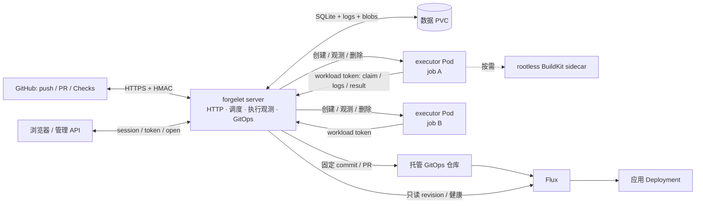
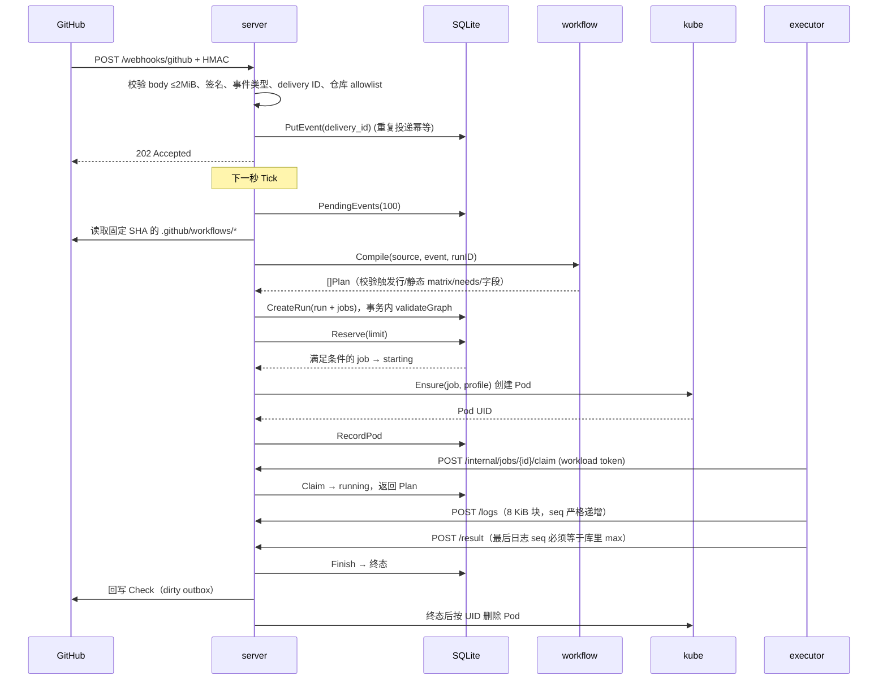
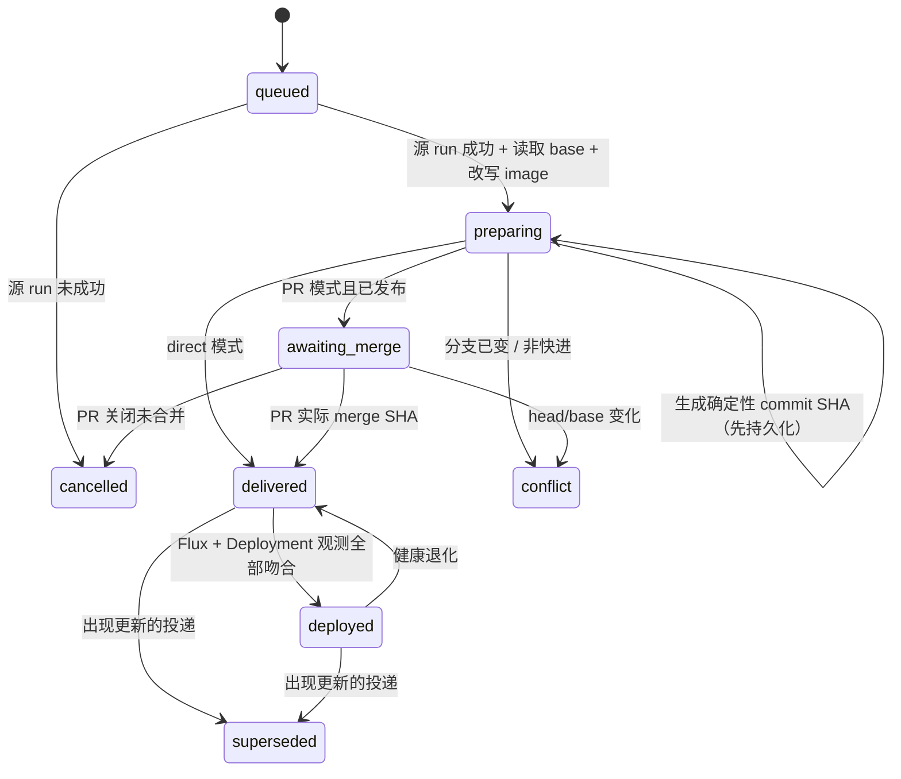

# 项目总览：代码地图、运行流程与设计

更新：2026-10-25。本文把**当前实现**串成一张可追踪的图：代码在哪里、一次运行怎么走、状态如何持久化、为什么这样取舍。
设计论证见 [architecture.md](architecture.md)，完成情况与验证记录见 [status.md](status.md)，后续任务见 [plan.md](plan.md)，
Actions 边界见 [compatibility.md](compatibility.md)，安装与恢复操作见 [deployment.md](deployment.md)。

## 1. 一句话

forgelet 是给自有 k3s homelab 用的轻量 CI/CD：GitHub 只负责源码、事件与 Checks；
一个常驻 Go 控制面接收事件、编译 workflow、按需创建执行 Pod、保存日志与历史，并把成功的构建通过 GitOps 交给 Flux。

三个不变量决定了整个实现：

1. **控制面只有一个进程、一个数据库、一个数据 PVC。** 没有 CRD、独立 controller、PostgreSQL、队列、Loki 或 MinIO。
2. **一个 job attempt = 一个原生 Pod + 一个 executor 进程。** steps 共享 workspace；Pod 失败不自动重试。
3. **数据库就是队列和状态机。** 进程重启后从 SQLite 继续；所有外部副作用都设计成可重试、可核对，而不是假设 exactly-once。

## 2. 运行形态



- 常驻组件只有 `cmd/forgelet` 一个 Pod；无任务时没有 executor Pod。
- `cmd/executor` 每个 job 启动一次，执行完即退出；它不依赖 Kubernetes client 或数据库。
- executor Pod 使用 `restartPolicy: Never`，不使用 Kubernetes Job 的自动重试。
- 控制面与 executor 之间的唯一通道是 HTTP（`/internal/jobs/{jobID}/...`），身份是绑定到 Pod 的短时 token。
- 构建器是 job Pod 内的 native sidecar（init container + `restartPolicy: Always`），只在 job 显式使用 `forgelet/build@v1` 且 profile 启用 build 时出现。

## 3. 代码地图

### 3.1 分层与依赖方向

```text
cmd/                    进程装配：读配置、建 client、启动 HTTP 与 tick
  └─ internal/server    HTTP、协调循环、管理/认证/接入 API
       ├─ internal/storage     SQLite 事务、队列、日志、备份、保留
       ├─ internal/workflow    纯逻辑：YAML → 计划、触发、matrix、依赖、Action metadata
       ├─ internal/expression  纯逻辑：条件/插值子集
       ├─ internal/kube        Pod 构造、观测、身份、BuildKit、Flux 只读
       ├─ internal/delivery    GitOps 意图与状态机
       ├─ internal/provider/github  App/JWT、事件、workflow、Checks、Git Data、OAuth、发现
       ├─ internal/blob        本地 artifact/cache 存储
       └─ internal/webui       嵌入前端产物
  └─ internal/executor  单 job 执行：shell、checkout、Node/Composite、builtins、日志/脱敏
       ├─ internal/workflow   仅用于解析 action.yml
       ├─ internal/action     固定 SHA Action 引用与有界下载
       └─ internal/blob       tar 打包/解包与路径检查
```

`internal/run` 只有数据类型与状态常量，`internal/expression` 没有 I/O。`storage` 为了在调度事务里求值 `if` 会 import `expression`，
这是有意的领域复用；除此之外没有 `common/shared/utils` 包。

### 3.2 包职责

| 包 | 关键入口 | 职责 | 主要测试 |
|---|---|---|---|
| `cmd/forgelet` | `main.go`、`serve`、`loadConfig` | 配置校验、TLS、GitHub/K8s/blob/delivery 装配、每秒 `Tick`、优雅退出、`--prepare-restore` | `main_test.go` 等 |
| `cmd/executor` | `main.go` | 只读环境变量并调用 `executor.RunRemote` | 由 executor 包测试覆盖 |
| `internal/run` | `model.go`、`contexts.go` | `Run/Job/Plan/Step/Result/State` 与表达式上下文 | `contexts_test.go` |
| `internal/workflow` | `Compile`、`Validate`、`ParseAction` | 单文档 YAML、字段白名单、触发过滤、静态 matrix、needs DAG、step/Action 编译、secret 引用 | `compile_test.go`、`matrix_test.go` 等 |
| `internal/expression` | `Evaluate`、`Validate`、`Interpolate`、`Eval` | 有界表达式：布尔/比较/逻辑/状态函数/字符串与 JSON 函数 | `expression_test.go` |
| `internal/action` | `Reference`、`Download`、`BuiltinInputs` | 只接受固定 40 位 SHA（及两个已验证别名）、有界 tar 解包、builtin 输入白名单 | `source_test.go` |
| `internal/storage` | `Open`、`Reserve`、`Claim`、`Finish`、`AppendLog`、`Prune`、`Backup`、`PrepareRestore` | 单连接 SQLite、目录 flock、事务化调度、JSON 记录、日志配额、保留、快照 | `scheduler_test.go`、`store_test.go` 等 |
| `internal/server` | `New`、`Handler`、`Tick`、`webhook`、`createRun`、`start` | 路由、认证、管理文档、协调循环、Pod 生命周期、Checks 回写、维护 | `server_test.go`、`auth_test.go`、`phase3_test.go` |
| `internal/kube` | `Runtime.Ensure/Observe/Delete/Pods/Authenticate`、`FluxObserver.Observe` | 原生 Pod 规格、owner label + UID、TokenReview、BuildKit sidecar、Flux/Deployment 只读观测 | `runtime_test.go`、`flux_test.go` |
| `internal/provider/github` | `New`、`ParsePush/ParsePullRequest`、`Workflows`、`ReportCheck`、`Discover`、`Prepare/Publish` | App JWT、限权 installation token、固定 SHA 读文件、Checks 幂等、Git Data/PR、OAuth、目录发现 | 各 adapter 单测 |
| `internal/delivery` | `Coordinator.Tick`、`advance`、`Rollback` | 投递状态机、target 校验、Kustomize image 改写、PR/merge SHA、Flux 观测、回滚 | `reconcile_test.go` |
| `internal/blob` | `Open`、`Put`、`Get`、`Pack/Unpack` | PVC 上有界对象、原子发布、TTL/配额、tar 路径安全 | `store_test.go` |
| `internal/executor` | `RunRemote`、`Execute`、`actionSession` | 领取计划、执行 shell/checkout/JS/Composite/builtins、日志脱敏与重试、取消轮询 | `engine_test.go`、`actions_test.go` |
| `internal/webui` + `web/` | `webui.Handler`、`web/src/router.tsx` | 嵌入 SPA、缓存/CSP、路由与页面 | Vitest + Playwright |

### 3.3 谁依赖谁（关键接口）

`internal/server` 不直接依赖 SQLite 或 client-go，而依赖三个接口（`internal/server/server.go:38-80`）：

- `Store`：事件、运行、日志、Checks、备份、保留。
- `Runtime`：`Ensure` / `Observe` / `Delete` / `Pods` / `Authenticate`。
- `Provider`：读 workflow、签发 token、回写 Checks。

真实实现分别是 `storage.Store`、`kube.Runtime`、`github.Client`；测试可以替换成 fake，而不改变调度逻辑。
`delivery.Coordinator` 同样只依赖 `delivery.Store/Repository/Observer`。

## 4. 持久化模型

SQLite 使用 `modernc.org/sqlite`、单连接、WAL、`busy_timeout`、外键；`Open` 在数据目录建 `.forgelet.lock` 并 `flock`，
防止两个进程共用目录（`storage/store.go:67-174`）。schema 从 v1 自动迁移到 v5。

| 表 | 关键列 | 存什么 | 备注 |
|---|---|---|---|
| `metadata` | key, value | `management` 配置文档、`restore_required` 标记 | 单行有界 JSON |
| `events` | delivery_id PK, body, error, done, payload_expired | 原始事件 + 编译诊断 | 先持久化再 ACK |
| `runs` | id PK, delivery_id+workflow_path UNIQUE, body, installation_id | Run JSON | `state` 字段只是初始值，读取时由 jobs 聚合 |
| `jobs` | id PK, run_id, state, body, log_bytes, check_id, check_dirty, terminal_at, logs_expired | Job JSON（含完整 Plan/Result） | 调度、配额、Checks、保留都看这些列 |
| `logs` | (job_id, seq) PK, step_id, data | 日志块 | seq 从 1 单调递增 |
| `settings` | repository+kind+name PK, value | vars 明文 / secrets 密文 | 每类最多 100 项 |
| `deliveries` | id PK, run_id, target, state, version, body | GitOps 投递 JSON | `version` 做 CAS |
| `auth_admin` | id=1, username, password_hash, github_id, github_token | 单管理员 | token 为 AES-GCM 密文 |
| `auth_sessions` | hash PK, expires_at | 会话摘要 | 最多 32 个 |
| `auth_flows` | hash PK, body, expires_at | 密封的 OAuth flow | 最多 16 个，10 分钟 |
| `run_tombstones` | id, delivery_id+workflow_path | 已清理运行的身份 | 旧 webhook 不会重新执行 |

几个容易忽略的点：

- `Run.State` 不是独立状态列。`getRun` 读取该 run 的全部 jobs 后调用 `aggregate`，优先级为
  `failure > timed_out > interrupted > cancelled > skipped > success`；全部 queued 才是 queued。
- Plan 里 `RuntimeSecrets`、`ActionInputs`、`ActionPath` 标记 `json:"-"`，不会进入 SQLite；
  secret 只以 `SecretNames` 引用形式持久化。
- `PrepareRestore` 会把 queued/starting/running 的 job 标为 interrupted、隔离未处理事件和活跃投递、
  删除恢复出来的 session/flow，然后才移除 `restore_required`（`storage/store.go:351-391`）。
- 备份用 `VACUUM INTO` 生成一致性副本，在副本里写入 `restore_required`，同步后用 hard link 原子发布；
  不会复制活跃 `.db`，也不包含 `blobs/` 和加密主密钥。

## 5. 端到端流程

### 5.1 从 GitHub webhook 到一条 run



入口在 `internal/server/server.go:301`（`webhook`）和 `:436`（`createRun`）。事件处理在 `Tick` 内（`:779`），
且只在配置了 GitHub provider 时执行；没有 provider 时事件不会被消费。控制面配置了纯控制面 YAML 时可以完全不读 Git workflow 目录
（`eventWorkflows`，`internal/server/management.go:245`），但 webhook 仍需要 provider 才有签名校验与事件处理。

### 5.2 编译：什么被接受，什么被拒绝

`workflow.Compile` 是纯函数，不做网络/文件 I/O（`workflow/compile.go:32`）：

1. 源文件 ≤1 MiB，只允许一个 YAML document；拒绝 anchor/alias、深度 >32、节点 >10000。
2. 顶层字段白名单：`name/on/env/jobs/concurrency`；其他字段直接报错并带行号列号。
3. 触发：`push`、`pull_request`、`workflow_dispatch`；支持 branches/tags/paths 及 `-ignore`、PR `types`、dispatch inputs。
   path filters 需要完整 changed-file 列表，否则返回 `ErrFilesRequired`，由 server 调 GitHub compare 补齐后重新编译。
4. 每个 job 生成一个或多个 `Plan`（静态 matrix）；job 数 1–64，展开后 ≤256；每 job steps 1–256。
5. `needs` 必须是已声明的 job ID，检查自身/重复/未知/环。
6. step 只支持 `run` 或 `uses` 二选一；shell 只有 bash/sh；`working-directory`/checkout path 必须留在 workspace。
7. `uses` 只接受 `actions/checkout@v4`、两个固定 setup Action（或其精确别名）、builtin `uses`、本地 `./path`、
   或 `owner/repo[/path]@40位SHA`；未知 Action 输入在加载 `action.yml` 后诊断。
8. 表达式按阶段校验引用：编译期、调度期、执行期、Action 内各自允许的上下文不同（见 `compatibility.md`）。
9. `plan.SecretNames` 从 workflow/job/step 的 env、`run`、`working-directory` 和 Action `with` 中提取，实际值永远不进入 Plan。

`Validate` 复用同一编译器，但忽略“当前事件不匹配”的触发结果，用于管理页面保存/预检；
它仍然校验 job、依赖、profile 和表达式，避免分支过滤掩盖错误（`workflow/compile.go:36-41`）。

管理配置（仓库/workflow/targets）不放在安装 YAML 里，而是作为 SQLite `metadata.management` 单文档：

- 首次启动、尚未保存时，由安装文件的 `repositories/workflows/targets` 生成只读快照（`server/management.go:39`）。
- 保存时校验结构、profile、workflow 源码和 target 依赖，客户端 `version` 必须匹配；服务端再以旧值为 expected 做一次数据库 CAS（`SaveManagement`）。
- 保存与调度 tick 共用 `tickMu`，HTTP 读取走 `atomic.Pointer[Management]`；失败返回 409，不覆盖用户未提交内容。
- 保存后这三类配置以数据库为准，重启从 SQLite 加载；改 ConfigMap 不会覆盖页面设置。

### 5.3 调度：一次 tick 的顺序

`Server.Tick` 用 `tickMu` 串行化（`internal/server/server.go:777-940`），顺序是：

1. **磁盘水位检查**：`diskGuard.check`；默认低于 512 MiB 暂停、达到 1 GiB 恢复，中间区间保持原状态。
   探测失败按暂停处理；进程启动时也先处于暂停，直到达到恢复阈值。暂停只阻止准入，不阻止观测/清理。
2. **处理待处理事件**（最多 100）：编译、去重、写诊断；可重试错误保留事件，下一 tick 再来。
3. **观测活跃 job**（starting/running）：
   - Pod 不存在且已有 UID / 已请求取消 → `Interrupt`（取消意图则记为 cancelled）。
   - Pod 不存在且没有 UID → `start`（可能是创建成功但响应丢失，`Ensure` 会按名称核对 owner label/UID）。
   - 首次看到 Pod → `RecordPod`。
   - 已请求取消 → 删除 Pod。
   - Pod 已 Failed/Succeeded 但没有确认结果 → `Interrupt`，**不重放执行**。
4. **领取新 job**：`Reserve(limit)`，limit = `max_parallel`，磁盘暂停时为 0（仍做条件/跳过/fail-fast 收敛）。
5. **启动**：对每个 reserved job 调 `start`；`start` 再检查一次水位和 profile，创建 Pod 并记录 UID。
6. **回写 Checks**：`PendingChecks`（最多 100），按 commit + App + external_id 查已有 Check，创建/更新后 `SaveCheck`。
7. **Pod GC**：列出带 `forgelet.dev/job` label 的 Pod；终态且 UID 匹配的才删除。
8. **CD 协调**：`delivery.Coordinator.Tick`。
9. **维护**：到点执行保留清理（默认每 10 分钟；启动后第一次 tick 就会执行）。

`Reserve` 不是简单 `SELECT ... LIMIT`，而是在一个事务里逐页加载 queued run 的图（`storage/scheduler.go:67-187`）：

- 先 `reconcileJobConcurrency`：取消同一并发组里旧的 pending，必要时取消活跃执行。
- 统计 starting/running 占用全局额度。
- 对每个 queued run：`applyFailFast` → 依赖全部终态后求值 `if` → 跳过/失败/进入 starting。
- 跳过会立刻让子 job 可判定，所以同一事务内循环到不再变化。
- `matrixSlot` 限制同组 `max-parallel`；`concurrencySlot` 检查 workflow/job 并发组。
- 等待依赖或并发组不占额度，也不阻塞后续 run。

### 5.4 执行：executor 看到什么

`executor.RunRemote`（`executor/remote.go:45`）的顺序：

1. `POST /claim`，校验返回的 `JobID` 与自己的 `JOB_ID` 一致。
2. 如果计划里有 checkout 或 secret 引用，`GET /credentials` 取 clone URL/token 和该 job 引用的 secret 值。
3. 启动 `watchControl`：每秒轮询取消意图；只有传输错误或 5xx 才在 `retryTimeout` 内重试，超时则自行取消。
4. `Execute`：shell、checkout、JS/Composite、builtins 顺序执行；日志按行切块、跨块脱敏后上传。
5. 结束后做最后一次有界 flush，把 `LastLogSeq` 写进 result，再 `POST /result`。
6. 退出前必须尝试上报结果；上报失败则以错误退出，由 server 在观测到 Pod 结束时标 interrupted，不重放执行。

执行器内部的关键约束：

- `runProcess` 使用独立进程组，先 SIGTERM 再 SIGKILL；Linux 下把自己设为 child subreaper，回收孙进程。
- shell 默认 `bash --noprofile --norc -e -o pipefail`；工作目录和路径都经过 `withinWorkspace`（含 symlink 解析）。
- checkout 固定 SHA，`git init/remote/fetch/checkout --detach`；认证通过 `http.extraHeader` 传入，
  不写 `.git/config`；禁用 credential helper、hooks、redirect。
- JS Action 用真实 Node 子进程（`/opt/forgelet/node20|node24`），校验主版本；Composite 共享同一 workspace，
  嵌套深度 ≤8、总调用 ≤256；pre/main/post、STATE/OUTPUT/ENV/PATH 都实现。
- 日志脱敏：masker 保留尾缓冲处理跨块 secret；`::add-mask::` 动态注册；registry 凭证也预先注册。
- artifact/cache/build/deploy 是 `forgelet` 自己的 builtin，不下载同名 GitHub Action；输入白名单在编译期和执行期各查一次。

### 5.5 日志、结果与 Checks 的幂等

| 风险 | 处理 |
|---|---|
| 日志块响应丢失 | 同 `seq` + 同内容重试视为成功；同 seq 不同内容返回冲突。 |
| 结果响应丢失 | 终态已存时，完全相同的 result 幂等返回成功；不同 result 返回冲突。 |
| 结果早于最后日志 | `Finish` 要求 `result.LastLogSeq == max(seq)`，否则冲突。 |
| Pod 创建响应丢失 | `Ensure` 先按固定名称 Get；已存在则核对 label、SA、已记录 UID。 |
| Check 创建响应丢失 | 按 `head_sha + external_id + app_id` 搜索已有 Check，再决定 POST/PATCH。 |
| 终态已存但 Pod 未删 | 按 owner label + UID 幂等删除；`Delete` 带 UID precondition。 |
| 重启时 job 仍在跑 | SQLite 恢复额度与计划，继续观测原 UID；executor 有界重连。 |
| 重启时 Pod 已丢 | 标 interrupted，只有显式重跑才创建新 attempt。 |

日志上限：单 job 20 MiB（含每条记录开销），单块 64 KiB（executor 实际 8 KiB），待上传缓冲 1 MiB；
API 每页最多 256 块，SSE 支持断点，下载接口流式排空全部页。

### 5.6 CD：从 digest 到 Flux 健康

`forgelet/deploy@v1` 只接受预登记 target 和 `sha256:` digest，server 校验 target 的
`SourceRepository == job.Plan.Repository`、`SourceRef == job.Plan.Ref`、事件类型允许（`server/deliveries.go:13`）。
投递记录 ID 为 `sha256(runID + "\x00" + target)` 的前 16 字节，重复请求返回同一条。



判定 `deployed` 的条件同时要求（`delivery/reconcile.go:183-216`、`kube/flux.go`）：

- 目标分支仍包含记录的 revision，且目标文件里的 image 仍是该 digest；
- Kustomization 与 GitRepository 都 Ready，generation 已观测，source URL/branch 与 target 一致；
- GitRepository artifact revision 与 Kustomization lastAppliedRevision 一致；
- Flux inventory 包含该 namespace/Deployment；
- Deployment 实际 image 等于 `target.Image@digest`，更新/可用/就绪副本都等于期望副本。

回滚创建独立记录 `ID("rollback", originalID)`，digest 取 `PreviousDigest`，并带上 `ExpectedDigest`；
如果当前文件已经被更新镜像覆盖，进入 conflict 而不是覆盖别人。重复回滚返回同一条记录。

投递节流：非 deployed 的活跃状态（queued/preparing/awaiting_merge/delivered）每 30 秒推进；deployed 每 2 分钟观测；
新意图随 tick 立即处理。同一 target 的待发布/待合并投递串行，避免互相覆盖。

### 5.7 取消、超时、重启

| 场景 | 当前行为 |
|---|---|
| 管理员取消 run | queued 立即 cancelled；活跃 job 写 `cancel_requested`，下一 tick 删 Pod；确认停止前仍占额度。 |
| 整个 job 超时 | job context 到期，停止后续 step 和 Action post；job 记 timed_out。 |
| 单 step 超时 | 该 step timed_out，后续 `failure()/always()` 清理仍可执行；job 结论保持 timed_out。 |
| `continue-on-error` | 只忽略普通非零退出；日志/执行器/协议错误和超时不能被吞；step 保留 outcome 与 conclusion。 |
| run 的 matrix fail-fast | matrix 变体失败/超时/interrupted 时，同组其他变体写取消意图；同一事务内收敛。 |
| 控制面重启 | 不重放 job；按 SQLite 中的 UID 接管 Pod；未完成的 attempt 继续由原 executor 上报。 |
| Pod 丢失 | `Interrupt`，保留最后日志 seq；历史结果明确标记，不推断“从未执行”。 |
| 备份恢复 | 必须先 `--prepare-restore`：隔离非终态 job、事件、活跃 CD，撤销 session；不会自动续跑。 |

## 6. 状态机

### Job

```text
queued ──Reserve──> starting ──Claim──> running ──Finish──> success | failure | cancelled | timed_out
   │                    │                   │
   │                    └──Interrupt────────┴──> interrupted
   └──CancelRun / condition false──> cancelled / skipped
```

- `starting` 和 `running` 都占并发额度；`starting` 表示已预留但 Pod 未必创建。
- 终态不可倒退；重复 result 只允许完全相同的内容。
- `job.Plan.ContinueOnError` 在 `Finish` 里把“普通 failure 且 Error 为空”改成 success，
  但 `Result.State` 保留 failure，供 `needs.ID.result` 和页面区分 outcome/conclusion。

### Run

Run 状态由 jobs 聚合，不单独维护。全部 queued → queued；存在非终态 → running；
否则按 failure、timed_out、interrupted、cancelled、skipped 的顺序取第一个出现的状态，最后才是 success。

### Delivery

见 5.6。终态/非活跃状态：`superseded`、`cancelled`、`conflict`；其余为 active，参与串行与节流。

## 7. 设计取舍

| 选择 | 收益 | 代价 / 边界 |
|---|---|---|
| 单进程 + SQLite，而不是 PostgreSQL/队列 | 部署最小、事务一致、备份就是文件、没有额外常驻服务 | 无 HA；单写连接；长事务会阻塞读；WAL 不适合共享网络文件系统 |
| 数据库即队列，轮询 tick | 重启恢复简单；没有内存队列丢失；状态可查询 | 默认 1 秒调度延迟；外部 API 慢会拖长 tick；需要处理部分失败 |
| 一个 job 一个 Pod，steps 共享 workspace | 符合 Actions 语义；工具安装和环境变量自然传递；Pod 级隔离 | 每个 job 有冷启动；不能按 step 隔离；一个 job 的恶意代码可读同容器 secret |
| 原生 Pod + label/UID 所有权，不用 CRD/controller | 不引入 CRD、controller 和 watch 缓存；权限面小 | 需要自己实现 GC、接管和幂等；依赖固定命名与 label |
| executor 反向拉取 + 短时 workload token | executor 无 K8s RBAC；server 可以逐请求校验 Pod 身份 | token 文件对同容器可信代码可读；不是恶意代码沙箱 |
| 固定 SHA、不可变 digest、确定性 commit | 可复现、可重试、可审计；重跑不漂移 | 分支移动必须重新运行；不支持可变 tag 部署 |
| 显式兼容子集，未知字段直接报错 | 不会“看起来成功”但语义错误；诊断可定位 | 大量 Marketplace Action / DSL 不可用；需要持续补兼容矩阵 |
| 轮询而非 watch | 代码简单、无 informer 缓存、重启成本低 | 延迟与 API 调用量；CD 需要节流 |
| artifact/cache 放同一 PVC | 不引入 MinIO；与 SQLite 共用备份边界 | 备份 SQLite 不含 blob；cache 不是 LRU；容量需自己设限 |
| 登录内置于 server | 不引入 IdP/独立 auth 服务；session 只存摘要 | 只有单管理员；OAuth App 与 GitHub App 两套凭据；组织策略仍需人工确认 |
| rootless BuildKit native sidecar | 无 Docker socket/DinD；builder 随 job 终止 | 需要 k8s native sidecar 和节点 user namespace；builder 需要有限提权/Unconfined |

## 8. 信任边界

| 入口 | 认证 | 关键限制 |
|---|---|---|
| `POST /webhooks/github` | HMAC-SHA256 | body ≤2 MiB；只接受 push/PR；delivery ID 格式与去重；仓库必须 enabled |
| 管理 API | session / token / open（显式配置） | session/open 的写请求要求同源 + JSON；token 模式使用 Bearer；open 设计上只用于可信内网；session 不接受旧 Bearer 旁路 |
| `/internal/jobs/{id}/*` | TokenReview + Pod 名称/UID 与 job 绑定 | audience=forgelet，600 秒投影；executor SA 无 RBAC；只访问自己的 job |
| Actions 代码 | 无可信执行沙箱 | 仅可信仓库；fork PR 直接忽略；secret 对同容器代码可见；构建仅限白名单 registry |
| GitOps 写 | 控制面持有的 App token | step 只能提交预登记 target + digest；token 不下发 Pod；非强推 |
| Flux 观测 | 只读 RBAC 示例 | 只读指定 Kustomization/GitRepository/Deployment；不安装 Flux、不持有写权限 |

敏感数据的落点：

- GitHub clone/Checks/GitOps token 只在控制面内存和短期缓存中；clone token 只通过 `/credentials` 临时下发，不写计划。
- repo secrets 用 AES-256-GCM 加密，随机 nonce，AAD 为 `repository\0name`；主密钥 32 字节，独立于 SQLite。
- OAuth token 也用 AES-GCM，AAD 为 `auth\0github-token`；session 只存 SHA-256 摘要。
- 日志 mask 覆盖跨块、多行、动态 `::add-mask::` 和 registry 凭证；mask 不能阻止可信代码主动外传。

## 9. 验证地图

| 层次 | 命令 / 位置 | 覆盖什么 |
|---|---|---|
| 单元 + race + 真实 SQLite/HTTP | `make test` / `go test -race ./...` | 编译器、表达式、调度事务、存储、HTTP、认证、GitHub adapter、executor |
| 静态检查 | `make lint`、`make generate` | golangci-lint（含 integration tag）、生成检查 |
| 前端单测 | `make web-test` | TypeScript、格式、Vitest（运行过滤、依赖图、日志、API 错误） |
| 浏览器交互 | `make web-e2e` | 确定性 fixture API + Chromium：导航、筛选、日志、取消/重跑、发布、移动布局 |
| 真实 k3s | `make test-integration` | Testcontainers 临时 k3s、正式镜像、真实 Pod/身份/重启/取消/保留；BuildKit/registry/Flux/Git |
| 真实 homelab | 手工记录 | GitHub App、OAuth、push → CI → Checks → BuildKit → GitOps → Flux → 回滚；证据在 `docs/status.md` |

`make verify` 串起构建、race 测试、lint、generate、前端单测和 Chromium；`make test-integration` 单独运行，
不读取用户 kubeconfig。集成测试使用 GitHub API fixture，但 Git 对象、BuildKit、registry、Flux 和 Pod 是真实的。

当前文档记录（`docs/status.md` 阶段 8）：`make verify` 通过，35 个 Vitest、13 组 Chromium；
全量 Testcontainers 19 个叶子场景通过。**这些是文档记录的历史运行结果，不等于本次会话重新跑过。**

2026-10-25 实际部署：含 review #1/#2 修复的 server/executor 已更新到 homelab，1/1 Ready、0 restarts；
`/healthz` 200、`/api/auth/session` 为 session 模式、匿名 `/api/runs` 401、嵌入 UI bundle 正常；
部署前后 SQLite 快照均为 16 runs / 34 jobs / 1 admin。未触发新的真实 CI 运行。

修复后额外确认：`go test -race ./...` 通过，`golangci-lint run --build-tags integration` 0 issues，
`npm --prefix web run typecheck` 与 35 个 Vitest 通过。未重跑 `make verify`、Playwright 或 Testcontainers。

## 10. 当前边界与风险

按影响排序：

1. **实现只在工作分支。** 当前单进程实现和文档已提交到 `chore/homelab-reset-20261023` 并推送 `origin`，
   但 `main` 仍指向旧架构；需要在 review 后创建 PR 并决定合并方式，避免长期分支漂移。
2. **阶段 8 已部署，但没有新的真实 CI 运行。** 2026-10-25 已更新 server/executor 并验证健康、session、
   匿名 401、UI 和备份数据；本批没有触发 push/manual 运行，也没有扩大 GitHub App 授权。
   接入/首跑仍需在真实页面操作。
3. **没有安装生命周期同步。** 6.5 未实现：没有 installation/installation_repositories webhook、后台校正、
   撤权后的排队/凭证清理；6.3b 的批量启用与 rename 自动迁移也未实现。
4. **单点与调度延迟。** 单副本 Recreate；控制面不可用期间事件会堆积在 GitHub 重投/SQLite 中；
   tick 串行且每 tick 30 秒预算，外部 GitHub/Flux 慢会推迟其他工作。
5. **SQLite 单连接。** 事务内做多步 JSON 读写；大 run（256 jobs）和 100 条列表会增加单次 tick 延迟。
6. **Actions 兼容仍是子集。** 无 Docker Actions、reusable workflows、OIDC、完整 Marketplace、fork PR；
   `permissions` 字段未支持，`env` 的高级语义、problem matcher/annotation 等不完整。
7. **安全边界是“可信仓库”。** executor 与 secret、registry 凭证、构建上下文同容器；没有恶意代码沙箱；
   NetworkPolicy 未验证；fork PR 被忽略是当前的主要隔离手段。
8. **磁盘保护只是准入。** 只检测 `data_dir` 所在文件系统，不限制运行中写入、其他文件系统或 PVC request；
   低水位不会缩短保留期。
9. **备份不完整。** SQLite 快照不含 `blobs/`、GitHub/OAuth 凭据、TLS、App 私钥和加密主密钥；
   主密钥丢失则密文不可恢复。
10. **资源数字不是测量结果。** server 50m/128Mi、executor 100m/128Mi、PVC 10Gi 是起始配置，没有性能基线门禁。

## 11. 改动导航

| 想改什么 | 先读 |
|---|---|
| webhook 触发 / PR / filters | `internal/server/server.go`（`webhook`）、`internal/provider/github/events.go`、`pull_request.go`、`internal/workflow/triggers.go` |
| workflow 字段 / 校验 / matrix / needs | `internal/workflow/compile.go`、`matrix.go`、`dependencies.go`、`action.go` |
| 表达式 / 上下文 | `internal/expression/expression.go`、`template.go`、`internal/run/contexts.go` |
| 调度 / 并发 / 取消 | `internal/storage/scheduler.go`、`concurrency.go`、`internal/server/server.go`（`Tick`） |
| Pod / 身份 / BuildKit | `internal/kube/runtime.go`、`build.go`、`internal/server/server.go`（`authenticate`） |
| 执行器 / shell / JS / Composite | `internal/executor/engine.go`、`actions.go`、`remote.go`、`builtins.go` |
| artifact / cache | `internal/blob/store.go`、`archive.go`、`internal/executor/builtins.go` |
| Checks / Git 数据 / 发现 / OAuth | `internal/provider/github/checks.go`、`gitops.go`、`discovery.go`、`oauth.go` |
| CD / Flux / 回滚 | `internal/delivery/reconcile.go`、`model.go`、`internal/kube/flux.go` |
| 登录 / session / 仓库接入 | `internal/server/auth.go`、`onboarding.go`、`github_user.go`、`internal/storage/auth.go` |
| 页面 / 路由 / 状态 | `web/src/router.tsx`、`web/src/pages/`、`web/src/lib/queries.ts`、`api.ts` |
| 保留 / 备份 / 磁盘 | `internal/storage/retention.go`、`store.go`（`Backup`/`PrepareRestore`）、`internal/server/disk.go`、`maintenance.go` |
| 安装 / 部署 | `deploy/install.yaml`、`deploy/cd-rbac.example.yaml`、`Dockerfile`、`docs/deployment.md` |

## 12. 推荐阅读顺序

1. 本文（全局图）。
2. `docs/architecture.md`（为什么这样设计、边界与恢复语义）。
3. `docs/status.md`（做到哪、验证了什么、线上是什么版本）。
4. `docs/plan.md`（下一步和未完成项）。
5. `docs/compatibility.md`（具体 workflow/Actions 支持面）。
6. `docs/deployment.md`（如何安装、配置、备份和恢复）。
